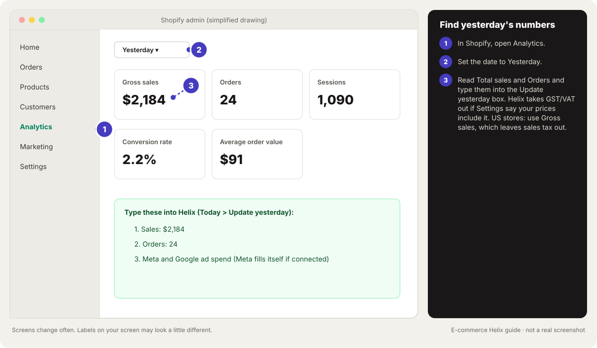
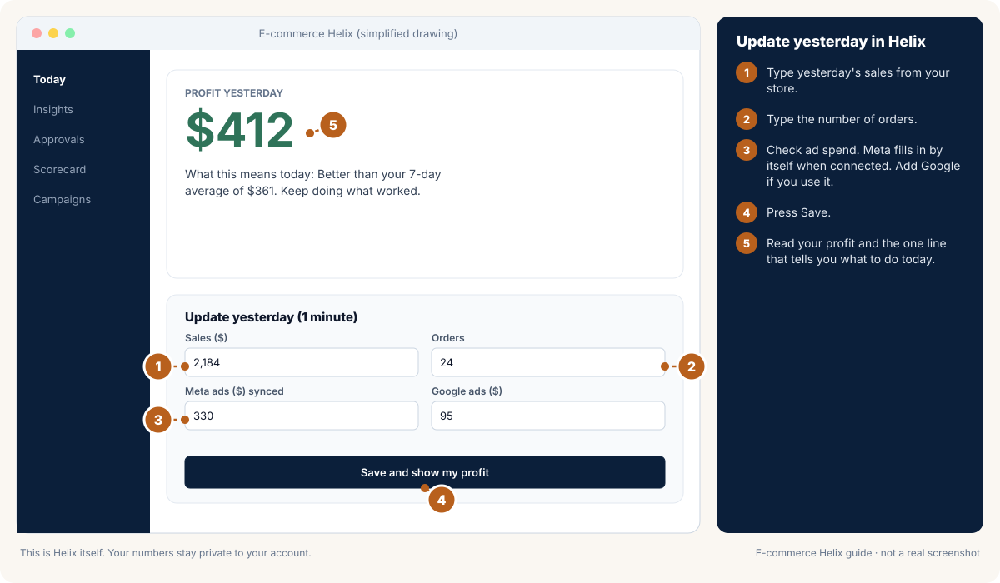
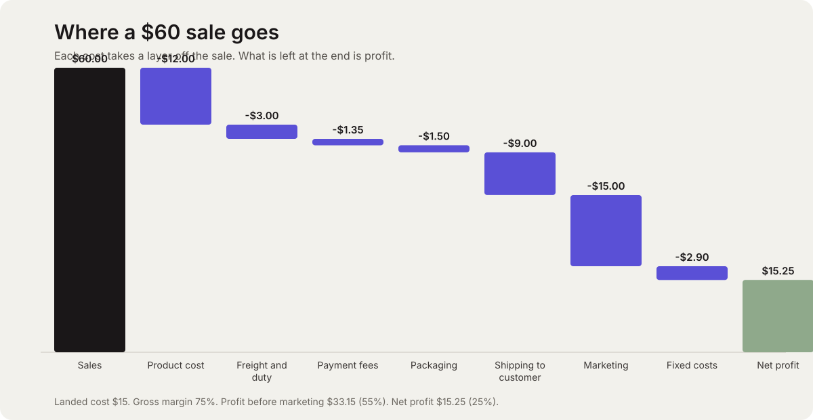

# Module 1: Daily profit foundations

**Outcome:** every morning you know if yesterday made money, and you know the few numbers that guide every other choice in this course.

**Time:** 60 to 90 minutes to set up once, then 2 minutes a day.
**Related SOPs:** [02 Scorecard](../sops/02-scorecard-and-unit-economics.md), [03 Constraint diagnosis](../sops/03-constraint-diagnosis.md)

<!-- plain:start -->
> **In plain words**
>
> **Stage:** Grow (keep more of every sale, then scale). Every lesson below is tagged with its stage; see [Attract, Convert, Grow](stages.md).
>
> **What it is:** Each morning you check one number: did yesterday make a profit?
>
> **Why it matters:** Sales can go up while you lose money. Profit is what pays you, so every other choice starts here.
>
> **Do this:**
>
> 1. Write down your costs once: product cost, shipping, payment fees and monthly bills.
> 2. Each morning, type yesterday's sales, orders and ad spend into Helix (2 minutes).
> 3. Read the profit number and the one line that tells you what to do today.
>
> **Words to know:**
>
> - **Profit:** What is left from sales after product cost, shipping, payment fees, discounts, refunds and ads. This is the number Helix cares about most.
> - **Revenue:** All the money customers paid. It looks good, but it is not what you keep.
> - **Break-even ROAS:** The ROAS where an order makes $0 profit after its costs. Below it, ads lose money.
> - **MER:** All ad spend divided by all sales, as a percentage. MER 25% means $25 of ads for every $100 of sales.
>
> All words are explained in the [glossary](../glossary.md).
<!-- plain:end -->

---

## Lesson 1.1: Why revenue is the wrong scoreboard
<!-- stage:grow -->

**Why this matters:** Revenue (all the money customers paid you) feels like success, but it does not tell you what you kept. A $5,000 day can still lose money once ads, product cost and shipping are paid, and ad platforms each claim the same sale, so their totals add up to more sales than you really had. This lesson gets you a real starting point so you can see the gap for yourself.

**Step 1.** Find last month's sales in your store.

1. In Shopify, click **Analytics**, then **Reports**.
2. Click **Total sales over time**.
3. Set the date at the top to **Last month**.
4. Write down the **Net sales** number (sales after discounts and refunds).

**Expected result:** You have one dollar figure for last month's net sales written in a note or on paper.

**Watch out:** Use the figure without GST or VAT. That tax belongs to the government, not to you.

**Step 2.** Add up last month's ad spend from every platform (Meta: **Ads Manager > Campaigns**, date range last month, total in the **Amount spent** column; Google Ads: **Campaigns > Cost**) and write down the total.

**Expected result:** You have one total ad spend figure for last month.

**Step 3.** Write down how much profit you think you made last month, as a single dollar number, before you do any maths.

**Expected result:** A guessed profit figure sits next to your sales and ad spend.

**Step 4.** Save the three numbers where you will find them again (a note on your phone, or the notes field in Helix Settings).

**Expected result:** You can find the note later. At the end of this module you compare your guess with the real contribution profit (sales minus order costs minus ads) and net profit (what is left after fixed bills too).

## Lesson 1.2: Your cost drivers
<!-- stage:grow -->

**Why this matters:** Cost drivers are your average costs, and they are what turn sales into profit. Get them roughly right once and every profit number in Helix becomes trustworthy. You set them up in about 30 minutes and check them every 3 months.

**Step 1.** Work out your **product cost %**: in Shopify go to **Analytics > Reports > Gross profit by product** (it needs "Cost per item" filled in on each product), or take your top 10 sellers and divide the landed unit cost (price paid plus freight and duty) by the selling price.

**Expected result:** You have one percentage, usually somewhere between 20% and 40% for most online stores.

**Watch out:** Use prices without GST or VAT, and include freight and duty, not just the factory price.

**Step 2.** Work out your **shipping and fulfilment cost per order**: take last month's carrier or warehouse (3PL, a company that stores and ships for you) invoices and divide by the number of orders shipped.

**Expected result:** You have a dollar amount per order, for example $9.

**Step 3.** Add **packaging per order** (boxes, mailers, tape, inserts) by dividing last month's packaging spend by orders.

**Expected result:** You have a second per-order figure, often $0.50 to $2.

**Step 4.** Find your **payment fee %**: in Shopify go to **Settings > Payments** and read the card rate, or divide last month's total fees (from your payouts page) by sales.

**Expected result:** You have a percentage, usually 1.75% to 3.5% depending on card mix and buy now pay later use.

**Step 5.** List every **fixed cost** for a month: staff and contractors, a fair wage for yourself, software and apps, rent, insurance, accounting, loan interest and fixed marketing that is not ad spend (photo shoots, free product for creators, agency fees).

**Expected result:** You have one monthly total for fixed costs.

**Watch out:** Include your own wage even if you do not pay it yet. Leaving it out makes the business look healthier than it is.

**Step 6.** Save your fixed costs in Helix.

1. Open **Your numbers**, then **Targets and fixed costs**.
2. Type your monthly total into **Fixed costs per month**.
3. Click **Save targets**.

**Expected result:** The Dashboard's net profit now takes off a daily share of your fixed costs (monthly total divided by 30.4).

<!-- do:numbers -->

### Good to know

**Variable costs: they grow with every order:**

| Cost | How to work it out |
| --- | --- |
| Product cost % | What one item costs to land in your warehouse (the product, plus freight to you, plus import duties), divided by its selling price. Average it across what you sell. If your sales mix changes a lot, weight it by units sold in the last 90 days. |
| Fulfilment and shipping per order | What your warehouse or 3PL (a company that packs and ships for you) charges to pick and pack, plus postage. Take away what customers pay you for shipping. |
| Packaging per order | Box or mailer, tissue paper, inserts. |
| Payment fees | What Shopify Payments, Stripe or PayPal charge. If you do not know, use 2.6%. Your payment reports show the real figure. |
| Other per-order costs | Marketplace commission, a free gift with each order, shipping protection you pay for, buy now pay later fees. |

**Common questions**

1. **Is my own wage a cost?** Yes. Put a fair wage for yourself into fixed costs, even if you do not pay it yet. If you leave it out, the business will look healthier than it is.
2. **Do I include GST or VAT?** No. Use sales and costs without the tax you collect and pass on to the government.
3. **How do I handle returns?** Use sales after refunds (net revenue). If returns are big for you, add a returns cost per order: return postage plus stock you have to throw away.
4. **What about tariffs and duties on orders sent overseas?** Add them as a per-order cost for that country. Or keep a separate scorecard for each country.
5. **I make my products myself.** Your product cost % includes materials and the labour for each unit. Production staff on a salary go in fixed costs.
6. **I sell wholesale and retail.** Keep online retail separate. Give wholesale a fair share of the fixed costs.
7. **My costs will change soon.** Save each version of your costs with a start date. That keeps your past numbers accurate.
8. **I cannot get an exact average product cost.** Start with a sensible estimate from your top 10 sellers. A rough number you use every day beats a perfect number you never use.
9. **What happens to product cost during a sale?** Product cost % goes up when you discount, because the price drops while the cost stays the same. Use a separate cost setting for sale periods.
10. **I have several stores or regions.** Keep one scorecard per store or currency, then look at them combined.

## Lesson 1.3: The daily scorecard
<!-- stage:grow -->

**Why this matters:** The scorecard is a short daily record of the numbers that decide profit. In Helix it lives in **Your numbers**, and the quick version is the profit box on **Today**. You type in a handful of numbers and Helix works out the rest, so you never do the maths yourself.

**Step 1.** Each morning open Shopify **Analytics** with the date set to **Yesterday** and note **Gross sales**, **Orders**, **Discounts**, **Returns** and **Sessions** (a session is one visit to your store).

**Expected result:** You have five numbers for yesterday, taking under a minute.

**Step 2.** Note yesterday's ad spend for each channel (Meta **Amount spent**, Google **Cost**, TikTok **Cost**), or skip Meta if it is connected in Helix, because Helix syncs it every morning.

**Expected result:** You have one spend figure per channel you advertise on.

<!-- do:meta-connect -->

**Step 3.** Add yesterday's numbers in Helix.

1. Open **Today** in Helix.
2. In **Update yesterday**, type yesterday's sales, orders and ad spend.
3. Click **Save and show my profit**.

Want to add every cost too? Use **Your numbers > Fill in a day** instead.

**Expected result:** The profit box shows yesterday's profit with a plain-English line, and the Dashboard updates.

<!-- do:numbers -->

**Step 4.** Add the last 1 to 2 months in one go.

1. Open **Your numbers** and find **Import CSV**.
2. Click to download the template.
3. Open it and paste one row per day.
4. Save the file.
5. Click **Import** and pick the file.

**Expected result:** The Dashboard shows trends from day one instead of a single day.

**Watch out:** Dates must be in YYYY-MM-DD format, for example 2026-10-05, or the row is skipped.

### Good to know

**Helix then works out the rest for you:**

| Number | What it means | How it is worked out |
| --- | --- | --- |
| Variable costs | Costs that came with yesterday's orders | Revenue x product cost % + orders x per-order costs + revenue x payment fee % |
| Contribution profit | What is left after order costs and ads | Revenue - variable costs - ad spend |
| Net profit (estimate) | What the business really earned | Contribution profit - one day's share of fixed costs |
| MER % | How much of your sales went on ads | Ad spend ÷ revenue |
| VCR | How much of your sales went on order costs | Variable costs ÷ revenue |
| FCR | How much of your sales went on fixed bills | Fixed costs ÷ revenue |
| RPV | How much each visit is worth | Revenue ÷ sessions |
| Conversion rate | How many visits turn into orders | Orders ÷ sessions |
| AOV | Average order value | Revenue ÷ orders |
| Cost per visit | What ads paid for each visit | Ad spend ÷ sessions |
| Blended CAC | What ads paid for each new customer | Ad spend ÷ orders from new customers |

<!-- guide:shopify-1-yesterdays-numbers -->

*Drawing, not a real screenshot. Labels on your screen may look a little different.* Official help: [Shopify: reports and analytics](https://help.shopify.com/en/manual/reports-and-analytics/shopify-reports)
<!-- /guide:shopify-1-yesterdays-numbers -->

<!-- guide:helix-1-daily-update -->

*Drawing, not a real screenshot. Labels on your screen may look a little different.*
<!-- /guide:helix-1-daily-update -->

## Lesson 1.4: Healthy ranges
<!-- stage:grow -->

**Why this matters:** A number on its own means little until you know whether it is healthy. These ranges tell you at a glance what is fine, what to watch and what needs action. Helix colours each one green, amber or red for you.

**Step 1.** Open **Dashboard** in Helix and pick **Month** so you are looking at the last 30 days.

**Expected result:** You see metric cards with a coloured dot on each.

<!-- do:growth -->

**Step 2.** Compare your net profit % (net profit divided by net sales) with the table below. A common guide: 10% or more is healthy, 5 to 10% is thin, below 5% is a warning sign.

**Expected result:** You know which band your profit sits in.

**Step 3.** Compare your MER (marketing efficiency ratio: all ad spend divided by net sales) with your target MER from Lesson 1.5, and your VCR (variable cost ratio: product, shipping, packaging and fees divided by net sales) with the table.

**Expected result:** You know whether ads or order costs are the bigger squeeze.

**Step 4.** Write down the one number furthest outside its healthy range.

**Expected result:** You have a single number to work on first, which Module 2 shows you how to fix.

### Good to know

| Number | Healthy (a common guide) | Warning sign |
| --- | --- | --- |
| Net profit | 10 to 20% of sales | Below 5% |
| MER % (ads as a share of sales) | 20 to 35%. It falls as more customers come back and buy again. | Above 45% |
| VCR (order costs as a share of sales) | 30 to 45% | Above 50%. Above 60% makes growing with ads very hard. |
| FCR (fixed bills as a share of sales) | 10 to 20% | Above 30% |

## Lesson 1.5: Your target MER and break-even numbers
<!-- stage:grow -->

**Why this matters:** These numbers tell you how much you can spend on ads and still make money. They are the line in the sand for every ad decision, and once Helix knows your costs it calculates them for you. Doing it by hand once helps you trust them.

**Step 1.** Calculate your target MER: 100% minus VCR minus FCR (fixed cost ratio: fixed costs divided by net sales) minus the profit % you want. Example: 100 - 40 - 15 - 15 = 30%.

**Expected result:** You have a target MER, for example 30%, meaning you can spend $30 on ads for every $100 of sales, averaged over new and returning customers.

**Step 2.** Type that figure into **Your numbers > Targets and fixed costs > Target MER (%)** and click **Save targets**.

**Expected result:** Helix rates your MER green at or under this target on every screen.

<!-- do:numbers -->

**Step 3.** Calculate break-even ROAS (return on ad spend: sales from ads divided by ad spend) as 1 divided by (1 minus VCR). With VCR at 40%, 1 / 0.6 = 1.67.

**Expected result:** You know that any channel bringing back less than $1.67 for each $1 of ads loses money on every sale, before fixed costs.

**Step 4.** Calculate break-even CPA (cost per acquisition: ad spend for one sale) as AOV (average order value) times (1 minus VCR). With AOV $100 and VCR 40%: $60.

**Expected result:** You know the most you can pay for one sale before it loses money.

**Step 5.** Calculate target CPA as AOV times target MER. In the example: $100 x 30% = $30.

**Expected result:** You have a three-zone rule: cost per sale under $30 is good, $30 to $60 means watch it, above $60 means the ad loses money on every sale.

**Watch out:** Helix shows break-even ROAS and CPA on the Dashboard from your real numbers. If your hand maths differs a lot, check your cost drivers in Lesson 1.2.

## Lesson 1.6: A 2-minute morning routine
<!-- stage:grow -->

**Why this matters:** Two minutes each morning stops small problems from becoming expensive ones. You read one number, choose how hard to push today, and check nothing is broken. Over weeks, the decision log becomes your best teacher.

**Step 1.** Open **Today** in Helix and read the **Profit yesterday** number and the sentence under it.

**Expected result:** You know if yesterday made money and how it compares with your 7-day average.

<!-- do:numbers -->

**Step 2.** Compare your MER for the last 3 days and month to date with your target MER, then pick one stance: **Push** (under target, profit good: spend more), **Careful push** (close to target: spend a little more and watch), **Hold** (at target: keep spend the same) or **Defend** (over target: cut the weakest ads and fix the cause).

**Expected result:** You have one word for today's stance.

**Step 3.** Do a 3-minute emergency check.

1. On your phone, open your store.
2. Add a product to the cart and go to checkout. You don't need to pay.
3. In Meta Events Manager, check yesterday's purchases are showing.
4. Check your best seller is in stock.

**Expected result:** Site, checkout, tracking and stock are all confirmed working, or you have found the one thing to fix first.

**Watch out:** A sudden drop in reported sales with normal orders in Shopify usually means tracking broke, not that ads stopped working.

**Step 4.** Write one line in your decision log: what you decided and why (for example "Hold: MER 31% vs 30% target, waiting on new ads").

**Expected result:** Your log has a dated entry you can look back on next week.

## Lesson 1.7: Sales, costs and profit in plain English
<!-- stage:grow -->

**Why this matters:** Most new owners look at sales and feel rich, then wonder where the money went. Sales is not what you keep. Once you can see every layer that comes off a sale, you know which lever to pull.

**Sales** (also called **revenue**) is what customers pay you. In Helix it is shown without GST/VAT, because that money belongs to the tax office. From there, each cost takes a layer off:

1. **Product cost (COGS):** making or buying the item.
2. **Freight and duty:** getting it from the factory to you. Product cost plus freight and duty is your **landed cost**. Sales minus landed cost is **gross profit**, and as a share of sales it is **gross margin**.
3. **Payment fees:** what Shopify Payments, PayPal or buy now pay later keep, usually about 1.75% plus 30 cents in Australia.
4. **Packaging:** mailer, box, tissue and inserts.
5. **Shipping to the customer:** the postage you pay. What is left now is **profit before marketing**, the money one order leaves to pay for ads and bills.
6. **Marketing:** ads and other marketing. What is left now is **contribution**.
7. **Fixed costs:** Shopify and app subscriptions, wages, rent and software, spread over your orders. What is left is **net profit**.

**Worked example: a $60 product made overseas.** It costs $12 to make and $3 to ship in with duty, so landed cost is $15 and gross margin is 75%. Payment fees take $1.35, packaging $1.50 and postage $9, leaving $33.15 before marketing. Ads cost $15 per order, leaving $18.15. Shopify, apps and other bills of $580 a month over 200 orders is $2.90 an order. Net profit is **$15.25 an order (25%)**, or about $3,050 a month. If ads crept up to $33 an order, every sale would lose money even though sales look the same.

**Step 1.** Write down one of your products and its selling price, then next to it write a cost for each of the seven layers in this lesson (product, freight and duty, payment fees, packaging, shipping, marketing, fixed costs), even as a guess.

**Expected result:** You have a rough cost for every layer of one order.

**Step 2.** Take the layers away from the price, top to bottom, and circle the biggest one.

**Expected result:** You know your rough profit per order and the single biggest cost eating it.

**Watch out:** Free shipping is not free. If you do not charge for postage, the whole postage cost is a layer you pay on every order.

## Lesson 1.8: Set up your profit dashboard
<!-- stage:grow -->

**Why this matters:** Every number Helix shows you later (profit yesterday, break-even, how much you can spend on ads) depends on knowing your costs. Five minutes here makes every other screen honest.

**Step 1.** Enter the costs of one typical order in **Profit setup**.

1. Open **Profit** in Helix.
2. Pick your best seller (or an average order if you sell many products).
3. Type its selling price.
4. Type each cost: product, freight and duty, packaging, shipping to the customer, payment fees.

**Expected result:** The waterfall on the right shows your profit per order and your break-even numbers.

<!-- do:profit -->

**Step 2.** Enter your monthly costs: your Shopify or website plan, every app subscription, and any wages, rent or software. Then enter how many orders you get in a usual month, or your goal if you are just starting.

**Expected result:** You can see your net profit for a month at that number of orders.

**Step 3.** Enter marketing per order (last month's ad spend divided by orders), tick "Use my monthly costs as fixed costs" and save.

**Expected result:** Profit setup is saved and your dashboard uses your real fixed costs.

**Watch out:** Check your app list in Shopify settings. Forgotten subscriptions of $10 to $50 each often add up to hundreds a month.

## Lesson 1.9: How much to spend on marketing
<!-- stage:grow -->

**Why this matters:** Spend too little and the store never grows. Spend too much and every sale loses money. A share of sales gives you a sense check, and your own margin tells you the hard limit.

**Your hard limit comes from your margin, not from a rule.** Take profit before marketing as a share of sales. That is your **break-even MER**: marketing at that share of sales leaves exactly zero. **Break-even ROAS** is 1 divided by it. In the $60 example, profit before marketing is $33.15, so break-even MER is 55% and break-even ROAS is 1.81. Your **break-even cost per purchase** is the same $33.15: pay more than that in ads to win one order and you lose money on it.

**Guides by stage (guides, not rules):**

- **Before your first sales or under about $5,000 a month:** a percentage target means little yet. Set a small fixed test budget you can afford to lose, for example $20 to $50 a day for two weeks, and judge each test by cost per purchase against your break-even cost per purchase.
- **Growing (about $5,000 to $80,000 a month):** total marketing commonly runs at about 10% to 30% of sales, depending on your margin and stage. Newer brands buying growth sit near the top; brands with lots of returning customers sit lower.
- **Scaling (over about $80,000 a month):** many brands sit around 15% to 25% of sales on all marketing. Spending more is fine while contribution margin stays positive and returning customers grow, because those customers pay back the cost of winning them.

High margin products can afford a higher share; low margin products cannot. Always leave room between your marketing share and your break-even for fixed costs and profit.

**Step 1.** Open **Profit setup** and read your break-even MER, break-even ROAS and break-even cost per purchase.

**Expected result:** You know the marketing share at which you stop making money.

**Step 2.** Choose your target MER (ads as a share of sales).

1. Pick a number well below your break-even, for example break-even 55%, target 25%. The gap pays your fixed costs and your profit.
2. In Helix, open **Settings**.
3. Type it in **Target MER**.
4. No sales yet? Write down a fixed daily test budget instead, for example $20 a day.

**Expected result:** You have a target MER, or a fixed test budget, written down.

**Step 3.** Open **Growth** and compare your marketing share with the guide band for your size.

**Expected result:** You know whether you are under, inside or over the usual range, and what that means for your margin.

**Watch out:** Count all marketing, not just Meta: Google, TikTok, influencers, discount codes paid to creators and agency fees all belong in marketing share.

## Example

A candle store had this day:

- Revenue $1,800, 30 orders, 900 sessions, $520 ad spend.
- Product cost 28%. Fulfilment $9 per order. Packaging $1.20 per order. Payment fees 2.6%.
- Fixed costs $9,000 a month.

Working it out step by step:

1. Variable costs = 1,800 x 0.306 (product cost + fees) + 30 x $10.20 (fulfilment + packaging) = $551 + $306 = $857. That is 48% of sales (VCR 48%).
2. Contribution profit = 1,800 - 857 - 520 = $423.
3. Fixed costs per day = $9,000 ÷ 30 = $300. Net profit is about $123, or 7% of sales.
4. MER = 520 ÷ 1,800 = 29%. RPV = $2.00 per visit. AOV = $60.

**What it shows:** MER (ads) looks fine. The real squeeze is VCR at 48%. Shipping costs $9 on a $60 order, which is 15% of every sale. The fix is cheaper shipping and bigger orders, not ads.

## Lesson 1.10: Track your numbers in a spreadsheet
<!-- stage:grow -->

**Why this matters:** Writing your numbers down every day is how you see trouble early. A simple sheet does the maths for you, so you only type what happened.

**Step 1.** Download the Helix tracking sheet.

1. Open [the sheet download](/downloads/helix-metrics-tracker.xlsx).
2. Save it somewhere you can find it, like your Desktop.

**Expected result:** You have a file called helix-metrics-tracker.xlsx.

**Step 2.** Open it in the app you like.

- Excel or Numbers: double-click the file.
- Google Sheets: go to sheets.google.com and open a blank sheet.
- Click **File**, then **Import**.
- Click **Upload** and pick the file.

**Expected result:** You see a tab called **Start here** with short instructions.

**Step 3.** Click the **Daily** tab at the bottom.

**Expected result:** You see yellow boxes (you type here) and blue boxes (they work themselves out).

**Step 4.** In the first yellow row, type yesterday's date in **Date**.

**Expected result:** The date shows like 2026-10-12.

**Step 5.** Type yesterday's sales in **Sales**. Find it in Shopify: click **Analytics**, then look at **Total sales** for yesterday.

**Expected result:** A number shows in the Sales box.

**Step 6.** Type yesterday's orders in **Orders** and visits in **Visits**. Both are on the same Shopify **Analytics** page (visits are called **Sessions**).

**Expected result:** Two more numbers are filled in.

**Step 7.** Type what you spent on ads yesterday.

1. Meta: in Ads Manager, find **Amount spent** for yesterday. Type it in **Meta ad spend**.
2. Google: in Google Ads, find **Cost** for yesterday. Type it in **Google ad spend**.

**Expected result:** The blue **Total ad spend** box now shows the two added together.

**Step 8.** Type your costs for yesterday.

1. Type what the products cost you in **Product cost**.
2. Type what you paid to ship in **Shipping cost**.
3. Type card and PayPal fees in **Payment fees**. Not sure of any number? Use the one from your Helix **Profit** page.

**Expected result:** The blue **Profit** box fills in. Green means you made money. Red means you lost money.

**Step 9.** Read the blue boxes.

- **ROAS** (return on ad spend): sales for each $1 of ads.
- **Conversion rate**: how many in 100 visits bought.
- **AOV** (average order value): what one order is worth.
- **MER** (marketing efficiency ratio): ad spend as a share of sales. Lower is better.

**Expected result:** You can say, in one sentence, whether yesterday made money.

**Step 10.** Each Monday, open the **Summary** tab.

**Expected result:** You see your totals for every day you filled in, including total profit.

**Watch out:** Only type in the yellow boxes. If you type over a blue box, download a fresh copy and paste your yellow rows back in.

## Self-check

1. Why are the sales numbers inside ad platforms a poor scoreboard?
2. Where does a founder's wage go?
3. VCR is 45%, FCR is 20% and you want 10% profit. What is your target MER?
4. AOV is $80 and VCR is 40%. What is break-even CPA?
5. MER is on target but profit is thin. Which number do you check next?

Answers

1. Each platform counts the same sale and uses its own rules for what counts. Your bank account only counts each sale once.
2. In fixed costs.
3. 100 - 45 - 20 - 10 = 25%.
4. 80 x 0.6 = $48.
5. VCR (order costs), then FCR (fixed bills).

