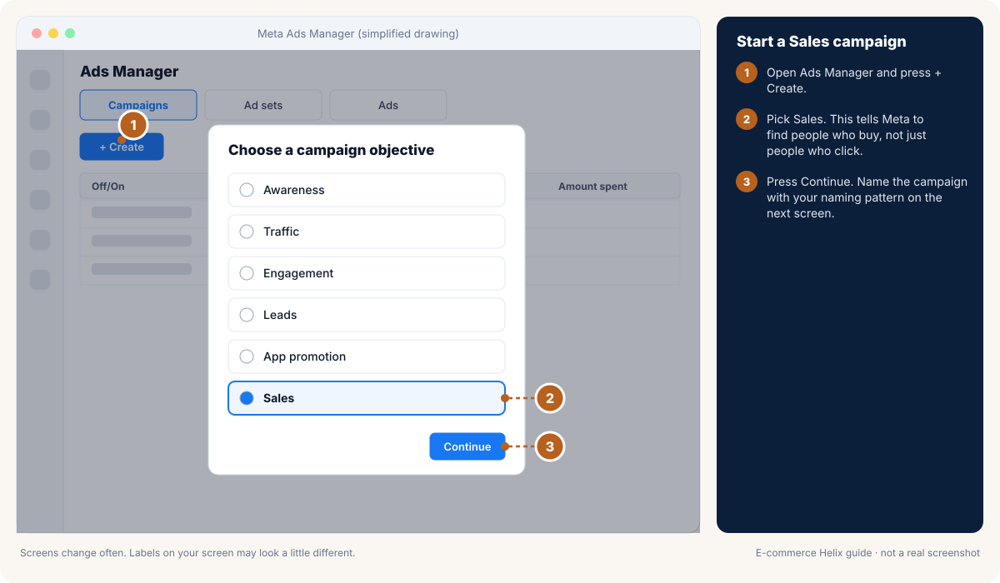
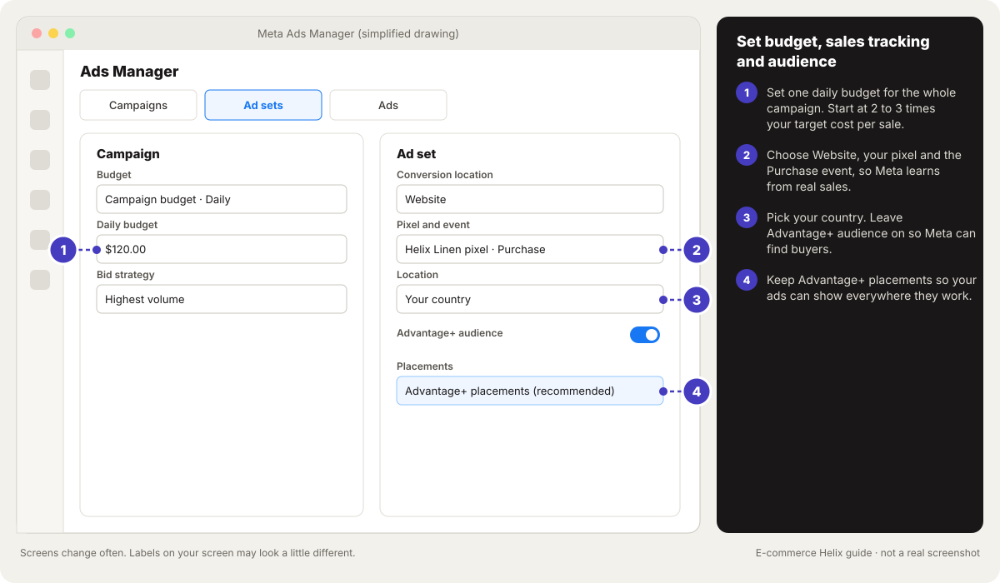
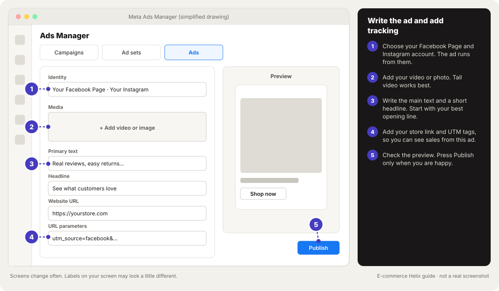
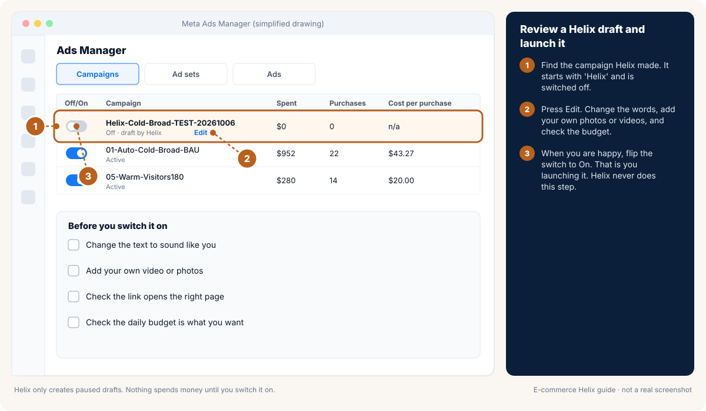
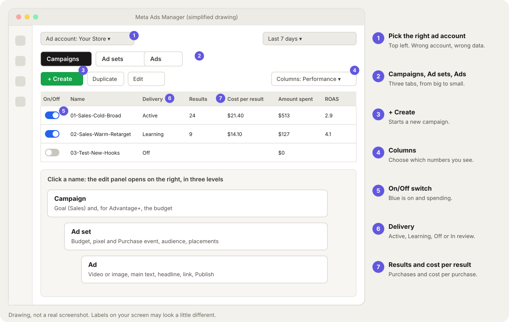

# Module 7: Meta ads in practice

**Outcome:** you can build and run a Meta (Facebook and Instagram) ad account in about 10 minutes a day, and spend more without breaking what works.

**Related SOPs:** [05 Meta structure and scaling](../sops/05-meta-structure-and-scaling.md), [06 Meta daily optimisation](../sops/06-meta-daily-optimisation.md), [07 Creative testing](../sops/07-creative-testing.md)

<!-- plain:start -->
> **In plain words**
>
> **Stage:** Attract (get seen by people who want what you sell). Every lesson below is tagged with its stage; see [Attract, Convert, Grow](stages.md).
>
> **What it is:** How to set up and run Facebook and Instagram ads in about 10 minutes a day.
>
> **Why it matters:** For most stores, Meta is where most new customers come from. Doing the basics well beats clever tricks.
>
> **Do this:**
>
> 1. Set up your pixel so Meta can see sales.
> 2. Start one Sales campaign with broad targeting and 3 ads.
> 3. Each day, check cost per sale against your target and act on the plain-English verdict in Helix.
>
> **Words to know:**
>
> - **Pixel:** A small piece of code on your store that tells Meta when someone views, adds to cart or buys.
> - **Advantage+:** Meta's automatic settings that let its system choose audience, placements or budget for you.
> - **Learning phase:** The first days after you start or change an ad set, while Meta works out who to show it to. Results jump around, so wait.
> - **CPA:** Cost per acquisition: how much ad money it took to get one sale.
>
> All words are explained in the [glossary](../glossary.md).
<!-- plain:end -->

---

## Lesson 7.1: Account setup checklist
<!-- stage:attract -->

**Why this matters:** Ten minutes of setup before you spend money prevents the most expensive Meta problems: lost sales tracking, hacked accounts and runaway spend. Do it once, one step at a time, and check it again every quarter.

**Where things live:** **Ads Manager** (adsmanager.facebook.com) is where you build and watch ads. **Business Settings** (business.facebook.com/settings) is where people, security and payment live. **Events Manager** is where your pixel lives. If you land in **Meta Business Suite** instead, click **All tools** (the grid icon in the left menu) and pick the tool by name.

**Step 1.** Go to business.facebook.com/settings, click **Users > People**, then **Add**, and invite a second person you trust as an admin.

**Expected result:** **People** lists two admins.

**Watch out:** One admin is a single point of failure. If that person is locked out or hacked, you lose the account.

**Step 2.** In the same Business Settings, open **Security Centre** and switch on **Two-factor authentication** (a code from your phone as well as a password) for everyone.

**Expected result:** Security Centre shows two-factor required for all admins.

**Step 3.** Still in **Security Centre**, click **Start verification** and follow the prompts to verify your business with your business name, address and phone.

**Expected result:** Verification shows "In review" or "Verified". If you do not see the button, your business may already be verified or not yet eligible: skip and come back later.

**Step 4.** Install the Facebook & Instagram app in Shopify.

1. In Shopify, click **Apps**.
2. Search for **Facebook & Instagram**.
3. Click **Install**.
4. Log in with your Facebook account when it asks.

**Expected result:** The app shows your business, ad account, Page and pixel as connected.

<!-- do:meta-connect -->

**Step 5.** Turn data sharing up to Maximum.

1. In the Facebook & Instagram app in Shopify, open **Settings**, then **Data sharing**.
2. Choose **Maximum**.

This sends sales to Meta from the shopper's browser (the pixel) and from your store (the Conversions API), so fewer sales go missing.

**Expected result:** Data sharing reads "Maximum".

**Step 6.** Open **Events Manager** (All tools > Events Manager), click your pixel, and look at the **Purchase** row in the **Overview** tab.

**Expected result:** Purchase shows events from both **Browser** and **Server**, in your store's currency. If it shows nothing, place a small test order and check again in an hour.

**Step 7.** Set a spending limit so ads can never spend more than you choose.

1. In Ads Manager, click the menu (three lines, top left).
2. Click **Billing and payments**, then **Payment settings**.
3. Find **Account spending limit** and click **Set limit**.
4. Type the most you are happy to spend in total, and save.

**Expected result:** The account stops spending at your limit even if something goes wrong.

**Step 8.** Make a simple "Daily" view in Ads Manager.

1. Click **Columns** (above the table), then **Customise columns**.
2. Tick: Results, Cost per result, Amount spent, Purchase ROAS (sales for each $1 of ads), CTR (link) (how many in 100 clicked) and Frequency (how often each person saw it).
3. Tick **Save as preset** and name it "Daily".
4. Click **Apply**.

**Expected result:** Choosing **Columns > Daily** shows the numbers you check every day.

**Step 9.** Add a weekly 5-minute calendar reminder to look in Ads Manager for campaigns you did not create or budgets that jumped.

**Expected result:** A weekly check is in your calendar. If you ever find something odd: turn it off, remove unknown people in Business Settings, contact Meta support and dispute the charge with your bank.

<!-- do:calendar -->

**Step 10.** Later, once you have a few hundred visitors, save your visitor lists.

1. In Ads Manager, open **All tools**, then **Audiences**.
2. Click **Create audience**, then **Custom audience**, then **Website**.
3. Make "All visitors, last 30 days" and save.
4. Do the same for 180 days, and for purchasers.

**Expected result:** The audiences show "Ready" (they can take a few hours to fill).

## Lesson 7.2: Automated vs manual campaigns
<!-- stage:attract -->

**Why this matters:** Meta offers two ways to run a sales campaign. **Advantage+** (automated) lets Meta choose who sees the ad, where and how the budget is split. **Manual** lets you choose the audience, exclusions and placements. Start with Advantage+ for new customers; use manual only when you need control.

**Step 1.** Start a new sales campaign.

1. In Ads Manager, click **+ Create**.
2. Choose **Sales** and click **Continue**.
3. Pick **Advantage+ sales campaign**. On some screens this is an **Advantage+ on** switch near the top: leave it on.

**Expected result:** Your main campaign for new customers is an Advantage+ Sales campaign.

<!-- do:meta-draft -->

**Step 2.** Only for warm audiences (people who visited or engaged) or a test that needs control, repeat **+ Create > Sales > Continue** and pick **Manual sales campaign** (or switch Advantage+ off).

**Expected result:** Warm and test campaigns are manual, with the audience you chose.

**Step 3.** At the ad level, scroll to **Advantage+ creative**, click **Edit** and switch off any change that alters how your ad looks (for example automatic carousels or added music).

**Expected result:** The preview on the right shows your ad as you designed it.

## Lesson 7.3: Ad formats
<!-- stage:attract -->

**Why this matters:** The format is the shape of the ad: video, image, carousel and more. Each format suits a different job, and the wrong one can hide a good message.

**Step 1.** For each ad in your next batch, pick the format from the table below that matches its job (for example single video in 9:16 and 4:5 for most cold ads).

**Expected result:** Every brief names one format.

**Step 2.** Make each ad in both 4:5 (feed) and 9:16 (Stories and Reels) sizes.

**Expected result:** Each ad fits every placement without cropping.

**Step 3.** Keep all text inside the safe zones so Reels and Stories do not cut it off or cover it with buttons.

**Expected result:** Previewing the ad in Ads Manager shows no text hidden behind buttons.

### Good to know

| Format | Best for |
| --- | --- |
| Single video (9:16 tall and 4:5) | Most ads aimed at new people |
| Single image (4:5) | Bold statements, offers, reviews |
| Carousel (swipeable cards) | Several products, steps or reasons |
| Catalog ads (dynamic product ads) | Showing people products they looked at; big product ranges |
| Collection | A shopping experience on mobile |
| Partnership ads | A creator's video run from the creator's own account |
| Catalog product video | Product videos made automatically from templates |

## Lesson 7.4: Launching
<!-- stage:attract -->

**Why this matters:** How you launch decides how fairly ads are tested and whether they keep their likes and comments. Build new ads in a switched-off campaign, copy them across with the same post, and switch them on together.

**Step 1.** Make the new ads in your switched-off build campaign.

1. In Ads Manager, open the build campaign (its On/Off switch is grey).
2. Click the **Ads** tab.
3. Click **+ Create** and make one new ad. Repeat for each ad.

**Expected result:** The new ads sit in the paused build campaign, with "Off" under **Delivery**.

<!-- do:meta-draft -->

**Step 2.** Copy the new ads into your live campaign.

1. Tick the new ads.
2. Click **Duplicate**.
3. Choose the live campaign and ad set.
4. Click **Duplicate** again.

**Expected result:** Copies of the ads appear in the live ad set, still switched off.

**Step 3.** Open each copy, and in the ad's **Ad setup** section choose **Use existing post**, then pick the original ad's post, so likes and comments carry over.

**Expected result:** Each copy shows the same post as the original. If you do not see **Use existing post**, the original has not been published yet: publish it in the build campaign first.

**Step 4.** Tick all the new copies and switch their On/Off toggles on together, then click **Publish** (bottom right) if Meta asks.

**Expected result:** All the new ads start on the same day, with **Delivery** showing "In review", then "Learning" or "Active".

**Step 5.** Leave them alone for 2 to 5 days before judging.

**Expected result:** You judge on settled numbers, not early noise.

**Watch out:** Only use ad scheduling for a specific reason, like a sale that starts at a set time.

### Good to know

<!-- guide:meta-1-create-sales-campaign -->

*Drawing, not a real screenshot. Labels on your screen may look a little different.* Official help: [Meta: create a campaign in Ads Manager](https://www.facebook.com/business/help/1658289035439772)
<!-- /guide:meta-1-create-sales-campaign -->

<!-- guide:meta-2-budget-pixel-audience -->

*Drawing, not a real screenshot. Labels on your screen may look a little different.*
<!-- /guide:meta-2-budget-pixel-audience -->

<!-- guide:meta-3-write-the-ad -->

*Drawing, not a real screenshot. Labels on your screen may look a little different.*
<!-- /guide:meta-3-write-the-ad -->

<!-- guide:meta-4-review-helix-draft -->

*Drawing, not a real screenshot. Labels on your screen may look a little different.*
<!-- /guide:meta-4-review-helix-draft -->

## Lesson 7.5: The learning phase
<!-- stage:attract -->

**Why this matters:** The learning phase is the first days after you start or change an ad set, while Meta works out who to show it to. Results are unstable during learning, so knowing what resets it saves you from breaking good campaigns.

**Step 1.** Before editing a live ad set, check whether the edit restarts learning: swapping or adding ads, changing the audience, or a big budget change (a common guide is more than 20%).

**Expected result:** You only make big edits on purpose.

**Step 2.** Launch new tests as new campaigns rather than editing working ones.

**Expected result:** Existing campaigns keep their learning, because new campaigns do not reset them.

**Step 3.** Judge results on the last 7 days, not one day.

**Expected result:** A great week one followed by a weaker week two does not panic you.

**Watch out:** Do not keep moving winning ads into "the best campaign". Copy them instead, so each campaign keeps what it learned.

## Lesson 7.6: Daily optimisation in 10 minutes
<!-- stage:attract -->

**Why this matters:** Ten minutes a day keeps Meta healthy. Five steps in the same order every day turn a confusing dashboard into one clear action. In Helix, **Your ads** shows the verdicts for you.

**Step 1.** Set your stance from your scorecard: push, careful push, hold or defend (Lesson 1.6).

**Expected result:** You have one word for today.

<!-- do:numbers -->

**Step 2.** In Ads Manager set the date to **Last 7 days**, choose **Columns > Daily**, and on the **Campaigns** tab read each campaign's **Amount spent** and **Frequency** (how many times the same person has seen your ads).

**Expected result:** You know whether any campaign is overspending or tiring its audience.

**Step 3.** Grade each ad: **Star** (great: keep and give more), **Steady** (fine: leave), **Passenger** (little spend, little effect: leave unless it starts spending), **Drain** (lots of spend, poor results: turn off).

**Expected result:** Every ad has a grade, and drains are switched off.

**Step 4.** Label each campaign: winning, learning, shaky or dying.

**Expected result:** Every campaign has a label.

<!-- do:insights -->

**Step 5.** Take one action and write it in your decision log. [SOP 06](../sops/06-meta-daily-optimisation.md) has the full detail and numbers.

**Expected result:** One logged action a day, about 10 minutes in total.

## Lesson 7.7: Reach potential
<!-- stage:attract -->

**Why this matters:** Reach potential is how many people an ad can reach before the same people see it twice on average (a frequency of 2). An ad with a tiny reach cannot grow, even if its cost per sale is great.

**Step 1.** See which ads reach the most people.

1. In Ads Manager, open the **Ads** tab.
2. Set the date to **Last 7 days**.
3. Click **Columns**, then **Customise columns**. Tick **Reach** and **Frequency** and click **Apply**.
4. Click the **Reach** column header to sort.

**Expected result:** You can see which ads reach many people and which reach few.

**Step 2.** Mark ads with big reach and an OK cost per sale as growth candidates.

**Expected result:** You have a short list of ads that can take more spend.

**Step 3.** To spend more, pair your low-cost, low-reach ad with a high-reach ad in the same campaign.

**Expected result:** The campaign can grow without frequency climbing fast.

## Lesson 7.8: Managing expensive cold campaigns
<!-- stage:attract -->

**Why this matters:** Cold campaigns aimed at new people always look expensive, because Meta misses many sales they cause when people buy days later another way. Judging them wrongly leads to cutting the campaigns that feed the whole store.

**Step 1.** Compare cold campaigns only with other cold campaigns, never with warm ones.

**Expected result:** Your cold campaigns are ranked against each other.

**Step 2.** Watch the share of orders from new customers each week.

**Expected result:** You know whether cold spend is still bringing new buyers.

**Step 3.** Judge cold spend by your total MER (total ad spend as a share of total sales) trend on the Dashboard.

**Expected result:** You see the whole-store effect, not Meta's partial view.

**Watch out:** Cut cold spend only when MER gets worse and orders from new customers fall.

<!-- do:growth -->

## Lesson 7.9: Metrics by funnel layer
<!-- stage:attract -->

**Why this matters:** The funnel layer is how well the audience knows you: cold, mixed, warm or hot. Each layer has its own numbers to watch and its own allowance for cost per sale.

**Step 1.** Label each campaign with its layer using the naming pattern from Lesson 6.7.

**Expected result:** Every campaign name shows Cold, Mixed, Warm or Hot.

**Step 2.** Compare each campaign with the metrics and CPA (ad cost for one sale) allowance for its layer in the table below.

**Expected result:** You judge each campaign against the right benchmark.

### Good to know

| Layer | Who | Main numbers to watch |
| --- | --- | --- |
| Cold | Never heard of you | Reach, CPM, hook rate, outbound CTR, share of new customers, cost per sale compared with 2 times target |
| Mixed | Cold and warm together | Cost per sale compared with 1.25 times target, frequency, share who engaged |
| Warm | Visited or engaged | Cost per sale compared with target, frequency |
| Hot | Added to cart or started checkout | Cost per sale compared with 0.75 times target, frequency |

## Lesson 7.10: Scaling challenge
<!-- stage:grow -->

**Why this matters:** A scaling challenge is a planned 2 to 4 week push to spend more. Done with new ads ready and a loss limit set, even a failed challenge teaches you what is holding you back.

**Step 1.** Prepare 6 to 10 new ads before you start.

**Expected result:** Fresh ads are ready to add as frequency rises.

**Step 2.** Write down the most you are willing to lose.

**Expected result:** You have a dollar limit that ends the challenge.

**Step 3.** Each day, raise the budget a little.

1. Click the campaign name (Advantage+) or the ad set name (manual).
2. Raise **Daily budget** by 10 to 20%.
3. Click **Publish**.
4. Write today's spend and reach in your tracking sheet.

**Expected result:** You can see whether new spend is finding new people.

**Step 4.** Hold each new level for 10 to 14 days.

**Expected result:** MER has time to settle at each level.

**Step 5.** Read the result.

- Spend grew much faster than reach? Add new ads, or remove some exclusions.
- MER (total ad spend as a share of total sales) didn't settle? Go back one budget step and find out why.

**Expected result:** You have a clear next action, whether the challenge worked or not.

<!-- do:growth -->

## Lesson 7.11: Attribution settings
<!-- stage:attract -->

**Why this matters:** Attribution is how a platform decides which ad gets credit for a sale. Meta's default (for example 7 days after a click and 1 day after a view) is not the full truth, so you need a cross-check.

**Step 1.** In Ads Manager click **Columns > Compare attribution settings** and look at the incremental option where it is available (it tries to count only sales the ad truly caused).

**Expected result:** You can see how much of Meta's reported sales are likely extra sales.

**Step 2.** Each week, compare Meta's reported sales with your real sales in Shopify and with your MER (total ad spend as a share of total sales) on the Dashboard.

**Expected result:** You trust the store's numbers first and Meta's second.

<!-- do:growth -->

**Step 3.** When spend is big enough, run a holdout test (hide ads from a group and compare), as in Lesson 20.9.

**Expected result:** You have a measured answer to how many sales ads really cause.

## Lesson 7.12: Troubleshooting
<!-- stage:attract -->

**Why this matters:** Meta throws up a handful of common problems, from ads that will not spend to strange labels. Each has a known fix.

**Step 1.** Find your problem in the table below.

**Expected result:** You have the matching fix.

**Step 2.** Apply the fix and note it in your decision log with the date.

**Expected result:** The problem is fixed, and you can find what you did if it comes back.

### Good to know

| Problem | What to check |
| --- | --- |
| Ads only spend part of the budget | Budget too low for the audience, billing problems, policy limits, the schedule |
| Ads stuck "in processing" | Policy review or catalog errors. Wait 24 to 48 hours, then copy the ad and try again. |
| Meta adds a discount label you did not set | Promotions settings in the ad. Turn off automatic offers. |
| "Data restrictions applied" | Meta has put your store in a sensitive category. Ask for a review. |
| Instagram sells worse than Facebook | Usually fine. Judge both together. Only remove a placement with strong proof. |
| You reached the limit on ads | Archive dead ads. Combine ad sets. |

## Lesson 7.13: Launch your first Meta ad in 30 minutes
<!-- stage:attract -->

**Why this matters:** Most people stall on their first ad because Ads Manager has hundreds of settings. You need about eight of them. This lesson walks you through a simple, sensible first campaign: one Sales campaign, one ad set, 3 to 5 ads and a budget you have already decided you can afford. Or let Helix build it for you as a paused draft.

**Words you will see:** a **campaign** holds the goal (Sales). An **ad set** holds the budget, who sees it and where. An **ad** is the video or image people see. The **pixel** tells Meta when someone buys. **Advantage+** means Meta makes some choices for you, which works well for most new stores.

**Step 1.** Check your setup: in Events Manager (Ads Manager menu **> All tools > Events Manager**) your pixel shows **Purchase** events from your store. If it does not, do Lesson 7.1 steps 4 to 6 first.

**Expected result:** You can see Purchase events, so Meta can learn who buys.

<!-- do:meta-connect -->

**Step 2.** Pick your daily budget.

- Selling under about $5,000 a month? Use $20 to $50 a day for two weeks.
- Selling more? Use about 2 times your break-even cost per sale each day (Helix shows it in **Profit**), and stay inside your marketing % guide from Lesson 1.9.

**Expected result:** You have one daily budget written down, for example $30 a day.

<!-- do:profit -->

**Step 3.** Get 3 to 5 ads ready: short videos or images of your best seller, each with a different first line or opening (the "hook"), in 4:5 (feed) and 9:16 (Stories and Reels) sizes.

**Expected result:** 3 to 5 files in a folder, plus one main text and one headline you can reuse.

**Step 4.** Want Helix to build it? Click **Do it for me**, then skip to Step 9.

Helix makes the campaign, ad set and ads in your own ad account, switched off (paused). Nothing spends until you switch it on.

**Expected result:** A paused campaign named by Helix appears in Ads Manager, with "Off" under **Delivery**.

<!-- do:meta-draft -->

**Step 5.** Building it yourself? Create the campaign.

1. In Ads Manager, click **+ Create**.
2. Choose **Sales** and click **Continue**.
3. Keep **Advantage+ sales campaign** (or the **Advantage+ on** switch).
4. Name it "01-Sales-First" and click **Next**.

**Expected result:** The campaign settings page is open with Sales as the goal.

**Step 6.** In the budget box set your daily budget from Step 2, and under **Conversion** check that your pixel is selected and the event is **Purchase**.

**Expected result:** Budget and Purchase event are set. If you see **Conversion location**, choose **Website**.

**Step 7.** Leave the audience on Meta's suggestion and placements on **Advantage+ placements**, then click **Next** to reach the ad.

**Expected result:** You are on the ad screen. If Meta shows a country box, set it to the countries you ship to.

**Step 8.** Add your ads.

1. Click **Add media** and upload your 3 to 5 images or videos.
2. Paste your main text into **Primary text**.
3. Paste your headline into **Headline**.
4. Paste your product page link into **Website URL**.
5. Look at the preview on the right and pick the phone view. Check nothing is cut off.

**Expected result:** Every ad shows the right image or video, text and link, with nothing cut off.

**Step 9.** Go live.

- Built it yourself? Click **Publish** (bottom right).
- Helix built it? Open it in Ads Manager. Check the budget, the ads and the link. Then click its On/Off switch so it turns blue.

**Expected result:** **Delivery** shows "In review", then "Learning" within a day.

**Step 10.** Leave it alone for 3 days. Then compare cost per purchase with your break-even cost per purchase from your profit setup.

**Expected result:** After 3 days you know whether each ad is under, near or over break-even, and you keep the best ones running.

**Watch out:** Every edit during the first days restarts Meta's learning. Change nothing for 3 days unless something is broken, such as a wrong link.

## Lesson 7.14: Find your way around Ads Manager
<!-- stage:attract -->

**Why this matters:** Ads Manager looks busy, but you only use a handful of parts. Knowing what each one is for turns it from scary into a simple table you check for 5 minutes a day.

**The parts that matter:**

1. **Ad account** (top left): make sure it shows your store's account.
2. **Campaigns, Ad sets, Ads** tabs: three levels, from big (the goal) to small (what people see). Ticking a campaign filters the other tabs to it.
3. **+ Create**: starts a new campaign.
4. **Columns**: chooses which numbers the table shows. Save a "Daily" preset (Lesson 7.1).
5. **On/Off switch**: blue means on and spending; grey means off.
6. **Delivery**: **Active** (running), **Learning** (Meta is still working out who buys), **In review** (Meta is checking the ad), **Off**, or **Rejected** (click it to see why).
7. **Results** and **Cost per result**: for a Sales campaign, purchases and the cost of each purchase. **Amount spent** is what you paid. **ROAS** (return on ad spend) is sales divided by spend.
8. **Date range** (top right): set it to **Last 7 days** for daily checks.

**Step 1.** Open Ads Manager (adsmanager.facebook.com, or Meta Business Suite **> All tools > Ads Manager**) and check the ad account name at the top left.

**Expected result:** You are in your store's ad account.

**Step 2.** Set the date range at the top right to **Last 7 days**.

**Expected result:** The table shows the last week.

**Step 3.** Click **Columns** and choose your **Daily** preset (or **Performance** if you have not made one yet).

**Expected result:** You see Results, Cost per result, Amount spent and ROAS.

**Step 4.** Click the **Campaigns** tab, then click a campaign name to open its edit panel, and look at the three levels (campaign, ad set, ad) without changing anything. Close it with **X** or **Close**.

**Expected result:** You know where the budget, the audience and the ads live.

**Watch out:** Your screen may look a little different, because Meta tests new layouts. Look for the same words: Create, Columns, Delivery, Results. If a menu is missing, try the three-line menu at the top left or search the help centre for its name.

## Self-check

1. Name two edits that restart learning.
2. Why can an ad with a low cost per sale be a poor choice for scaling?
3. How should you judge cold campaigns?
4. What do you do if a campaign was hacked?

Answers

1. Any two of: a big budget change (a common guide is over 20%), adding or swapping ads, changing the audience.
2. It reaches few people before the same people see it again and again.
3. Against other cold campaigns, and by your total MER and new-customer trend.
4. Turn it off, remove unknown access, secure the admin logins, contact Meta support and dispute the charges.

