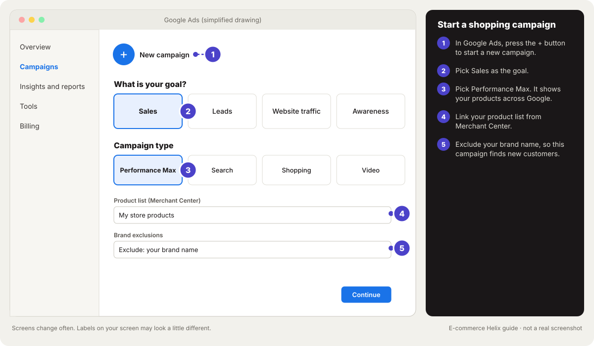
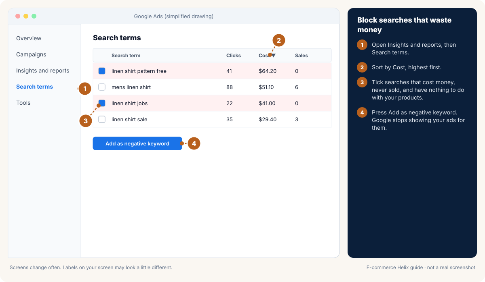

# Module 9: Ad performance analysis, audiences and campaign setup

**Outcome:** you can set up audiences and campaigns the right way on Meta, Google and TikTok. You can read your results and find the real cause of a problem. It may be the ad, the page, the offer or the checkout. Then you report it so it leads to a clear choice.

**Related:** [Module 7 Defining campaigns](07-defining-campaigns.md), [Module 8 Meta ads](08-meta-ads.md), [Module 10 Google ads](10-google-ads.md), [Module 2 Diagnose and fix](02-diagnose-and-fix.md), [SOP 05](../sops/05-meta-structure-and-scaling.md), [SOP 06](../sops/06-meta-daily-optimisation.md), [SOP 09](../sops/09-google-shopping-pmax-search.md)


<!-- plain:start -->
> **In plain words**
>
> **Stage:** Attract (get seen by people who want what you sell). Every lesson below is tagged with its stage; see [Attract, Convert, Grow](stages.md).
>
> **What it is:** How to set up ads correctly and read your results like a pro.
>
> **Why it matters:** Good setup means you can trust the numbers. Good reading means you fix the real problem.
>
> **Do this:**
>
> 1. Check that your pixel and sales tracking work before you spend.
> 2. Set up your campaign step by step (drawings below).
> 3. When results drop, check in order: the ad, the page, the offer, the checkout.
>
> **Words to know:**
>
> - **Pixel:** A small piece of code on your store that tells Meta when someone views, adds to cart or buys.
> - **UTM:** Tags added to the end of a link so your analytics can tell which ad or email a visitor came from.
> - **Attribution:** Deciding which ad or channel gets credit for a sale. Meta's default counts sales within 7 days of a click or 1 day of a view.
> - **Funnel:** The steps from seeing an ad to buying: visit, add to cart, checkout, order.
>
> All words are explained in the [glossary](../glossary.md).
<!-- plain:end -->

---

## Lesson 9.1: Before you launch: tracking you can trust
<!-- stage:attract -->

**Why this matters:** Bad data leads to bad decisions, and a broken pixel can make good ads look like failures. Check tracking once now, then every month. Your store's own reports are the truth; ad platforms are only for direction.

**Step 1.** Add the **Facebook & Instagram** sales channel in Shopify. Connect your business account, ad account, page and pixel (see [Shopify: Facebook and Instagram](https://help.shopify.com/en/manual/online-sales-channels/facebook-instagram-by-meta)).

**Expected result:** The sales channel shows all four connected.

<!-- do:meta-connect -->

**Step 2.** Set data sharing to **Maximum** to turn on server events.

**Expected result:** Sales reach Meta even when a browser blocks the pixel.

**Step 3.** Install the **Google & YouTube** app and connect Merchant Center, Google Ads and GA4 (see [Shopify: Google](https://help.shopify.com/en/manual/online-sales-channels/google)).

**Expected result:** Google receives your products and purchases.

**Step 4.** Check privacy and cookie settings in **Settings > Customer privacy** (see [Shopify: customer events](https://help.shopify.com/en/manual/promoting-marketing/analyze-marketing/customer-events)).

**Expected result:** Consent is handled for your markets.

**Step 5.** Open Meta Events Manager and Google Ads **Goals > Conversions**. Check that the pixel (or Google tag) and server events are connected through your store. Server events are the Conversions API on Meta and enhanced conversions on Google.

**Expected result:** Both show purchases from browser and server.

**Step 6.** Make Purchase the only primary (main) conversion for sales campaigns, with add to cart and others as secondary.

**Expected result:** Only Purchase is primary on each platform.

**Step 7.** In Events Manager's event details, check deduplication is on. It stops one sale being counted twice, from browser and server.

**Expected result:** Events Manager shows deduplicated purchase events.

**Step 8.** Verify your domain (Meta **Business Settings > Brand safety > Domains**). Set up a cookie banner for the countries you sell to.

**Expected result:** The domain shows Verified and the banner appears for visitors who need it.

**Step 9.** Add UTM tags (labels that tell reports where a visit came from) to every ad link, like `?utm_source=facebook`. Use the URL parameters field in each ad.

**Expected result:** Google Analytics shows visits by channel and campaign.

**Step 10.** Place a real test order (Lesson 13.14). Check Meta Events Manager and Google for the Purchase.

**Expected result:** One test order shows as a Purchase in both Meta and Google.

**Step 11.** Open that test order in each platform. Check the value and currency are right, then refund the order.

**Expected result:** The test purchase shows the right amount and currency.

### Good to know

## Lesson 9.2: Setting up target audiences
<!-- stage:attract -->

**Why this matters:** Audiences tell each platform who already knows you. Then cold campaigns find new people and warm campaigns reach the right ones. Set them up once on Meta, Google and TikTok, then reuse them in every campaign.

**Step 1.** On Meta, set audience groups for the whole account in **Advertising settings > Audience segments** (under **All tools**). Add your engaged audience (visitors and social engagers) and existing customers (customer list or store link).

**Expected result:** Reports show how much spend reaches brand-new people.

**Step 2.** On Meta, click **Audiences**, then **Create audience**, then **Custom audience**, once for each.

- Visitors, 30 days. Visitors, 180 days.
- Product viewers, 30 days.
- Added to cart, 14 days.
- Checkout started, 7 days.
- Buyers, 180 days. Buyers, all time (upload your customer list, as website audiences stop at 180 days).
- Instagram and Facebook engagers, 365 days.
- People who watched half a video, 90 days.
- Email subscribers (upload the list).

**Expected result:** Every custom audience shows "Ready".

**Step 3.** On Meta, build lookalikes of buyers or best customers. Make them at 1%, 3 to 5% and 10% for later tests.

**Expected result:** Three lookalike sizes are ready.

**Step 4.** Set cold targeting to broad: your country and age 18 to 65+. Pick all genders unless the product is clearly for one. Choose who to leave out of cold ads: nobody, recent buyers, or all buyers and engagers. Meta announced in 2025 it is retiring its old past-customer spend cap, so check Ads Manager for your account. To keep past buyers out of cold ads, exclude your customer audiences. Then watch the **Audience segments** breakdown.

**Expected result:** Cold campaigns reach new people on purpose.

**Watch out:** Meta announced in 2025 it is retiring its old past-customer spend cap (see [Meta for Developers: Advantage+ campaign changes](https://developers.facebook.com/blog/post/2025/06/03/advantage-plus-campaign-experience-for-sales-and-app/)). Don't plan around the cap. To keep past buyers out, exclude your customer audiences in the ad set instead.

**Step 5.** On Google, give it signals and words to avoid.

1. In **Audience manager**, upload your customer list as a customer match list.
2. Make remarketing lists: visitors 30 days, visitors 540 days (Google's maximum), cart abandoners, buyers.
3. In your Performance Max campaign, add these as audience signals.
4. Make a negative keyword list with words like "jobs", "free", "DIY" and brands you will not bid on.

**Expected result:** Google has signals to guide it and words to avoid.

**Step 6.** On TikTok, copy the same layers.

1. Target broad: just country and age.
2. Make custom audiences: visitors, video viewers, profile engagers, customer list.
3. Run Spark ads so posts keep their likes and comments.

**Expected result:** TikTok has the same audience layers as Meta.

**Step 7.** Map each audience to its layer using the table below.

**Expected result:** Every audience is labelled cold, mixed, warm, hot or existing customers.

### Good to know

| Layer | Who | Example targeting |
| --- | --- | --- |
| Cold | Never interacted with you | Broad, with harsh or light exclusions |
| Mixed | Anyone; the platform decides | Advantage+ sales campaign, with spend on existing customers watched in the **Audience segments** breakdown (Meta announced in 2025 it is retiring its old past-customer spend cap, so check Ads Manager) |
| Warm | Engaged but not bought | Visitors (180 days), engagers, video viewers, leaving out buyers |
| Hot | Close to buying | Added to cart (14 days), started checkout (7 days), leaving out buyers from the last 7 days |
| Existing customers | Bought before | Buyers, for launches and products people reorder |

## Lesson 9.3: Meta audience check: is cold spend reaching new people?
<!-- stage:attract -->

**Why this matters:** A "cold" campaign is meant to find new buyers. Meta's delivery system often drifts towards people who already know you, because they buy more easily. The results look great while very few new customers arrive. A 10-minute check each week shows where the money really goes.

**Step 1.** Make sure Meta knows who your audiences are. In **Advertising settings > Audience segments** (Lesson 9.2, Step 1), check that your engaged audience and existing customers are set and that the customer list is recent.

**Expected result:** Both segments are set, and the customer list was updated in the last 30 days.

**Step 2.** Open the breakdown. In Ads Manager, select one prospecting (cold) campaign and the last 7 days. Click **Breakdown**, then **Audience segments**.

**Expected result:** You see spend, purchases and cost per purchase split into new audience, engaged audience and existing customers.

**Step 3.** Work out the share of spend on new people: new audience spend divided by the campaign's total spend.

**Expected result:** You have one percentage for each cold campaign.

**Watch out:** A rule of thumb, not a Meta rule: aim for about 70% or more of cold spend on the new audience. Much lower means the campaign is mostly reselling to people who would likely have bought anyway.

**Step 4.** Check how often new people see your ads. Add the **Frequency** column with the same breakdown and the last 7 days.

**Expected result:** You know the frequency for the new audience.

**Watch out:** A rule of thumb: keep new-audience frequency under about 2 over 7 days. Higher usually means the audience is too small or the ads are too few or too alike.

**Step 5.** Find the cause and make one fix, using the table below.

**Expected result:** One change is made and written in your test log with today's date.

**Step 6.** In each cold ad set, exclude your customer audiences, so past buyers stay out on purpose.

**Expected result:** Cold ad sets exclude past buyers. If you want to reach past buyers, they have their own ad set that includes only your customer audience, with a spending limit on that ad set. Meta announced in 2025 it is retiring its old past-customer spend cap, and its own guide now splits new and existing customers into separate ad sets this way (see [Meta for Developers: Advantage+ campaign experience](https://developers.facebook.com/documentation/ads-commerce/marketing-api/advantage-campaigns)).

**Watch out:** Ads Manager names and screens change often. If the options look different in your account, search Meta Business Help Centre for "existing customers" before you change anything.

**Step 7.** Repeat the check every week, and after any big change, for 3 weeks.

**Expected result:** The new audience share and frequency move towards the rules of thumb, and the number of new customers in your store rises.

<!-- do:meta-connect -->

### Good to know

| What you see | Likely cause | Fix |
| --- | --- | --- |
| New audience share under about 70% | Past buyers and engagers not excluded; the system finds them cheaper | Exclude customer audiences in cold ad sets (Step 6) and check the customer list is up to date |
| New audience share fine, but few new customers in your store | Store reports count repeat buyers, or tracking is off | Compare new customers in Shopify with Meta's purchases (Lesson 9.1) |
| New audience frequency above about 2 in 7 days | Audience too narrow, or too few ads | Go broad (Lesson 9.2, Step 4) and add new ad ideas (Lesson 6.13) |
| Cost per purchase from new people far above target | The ad speaks to people who know you | Write for strangers: a clear problem, the product and proof (Lesson 5.5) |
| Engaged audience takes most of the spend | Retargeting mixed into a cold campaign | Move retargeting to its own warm campaign (Lesson 7.4) |

## Lesson 9.4: Setting up a Meta sales campaign step by step
<!-- stage:attract -->

**Why this matters:** Set up each Meta sales campaign the same careful way. Then every ad gets a fair test. Helix can build Steps 2 to 8 for you as a paused draft in your own account. You check it and switch it on. New to Ads Manager? Do Lesson 8.1 first, and Lesson 8.3 for your very first ad.

**Step 1.** Write the campaign brief first (Lesson 7.16). Include target cost per purchase, who it is for, daily budget and when you will stop it.

**Expected result:** The brief is finished before you open Ads Manager.

**Step 2.** Start the campaign.

1. In Ads Manager, click **+ Create**.
2. Choose **Sales** and click **Continue**.
3. Leave **Advantage+** on for new customers. For a controlled test, narrow the audience or placements later, and Meta shows **Advantage+ off** (Lesson 8.4).

**Expected result:** A new Sales campaign is open.

<!-- do:meta-draft -->

**Step 3.** Click the campaign name field and name it with your pattern, for example `03-Manual-Cold-Broad-TEST-B16` (Lesson 7.7).

**Expected result:** The name shows the number, type, audience and test.

**Step 4.** In the budget box, set a daily budget. Make it about 2 to 3 times your target cost per purchase. It sits on the campaign for Advantage+ and on the ad set for manual tests.

**Expected result:** The budget matches your brief.

**Step 5.** At the ad set level, under **Conversion**, choose **Website**, your pixel and the event **Purchase**.

**Expected result:** The ad set is set to find purchases.

**Step 6.** Find **Attribution setting** (click **Show more options** if you cannot see it). Keep **7-day click, 1-day view**, or whatever your other campaigns use, so results compare.

**Expected result:** All your campaigns count sales the same way.

**Step 7.** Set the audience as in Lesson 9.2 and leave **Advantage+ placements** on.

**Expected result:** Audience and placements match the brief.

**Step 8.** At the ad level, add 3 to 6 ads that test one thing. Each needs main text, a headline and a link with UTM tags (Lesson 9.1). Use **Duplicate** in the ad panel to make each extra ad.

**Expected result:** Each ad has text, headline and a tagged link.

**Step 9.** Stop Meta changing your ad.

1. In each ad, open **Advantage+ creative**, then **Edit**.
2. Switch off anything that changes your words or picture.
3. Check the preview on the right for Feed, Stories and Reels.

**Expected result:** Text sits inside the safe areas and each ad looks as designed.

**Step 10.** Click **Publish** (bottom right), then do not touch the campaign for 3 days unless something is broken.

**Expected result:** **Delivery** shows "In review", then "Learning", and the campaign learns undisturbed.

### Good to know

<!-- guide:meta-1-create-sales-campaign -->


*Drawing, not a real screenshot. Labels on your screen may look a little different.* Official help: [Meta: create a campaign in Ads Manager](https://www.facebook.com/business/help/1658289035439772)
<!-- /guide:meta-1-create-sales-campaign -->

<!-- guide:meta-2-budget-pixel-audience -->


*Drawing, not a real screenshot. Labels on your screen may look a little different.*
<!-- /guide:meta-2-budget-pixel-audience -->

<!-- guide:meta-3-write-the-ad -->


*Drawing, not a real screenshot. Labels on your screen may look a little different.*
<!-- /guide:meta-3-write-the-ad -->

<!-- guide:meta-4-review-helix-draft -->


*Drawing, not a real screenshot. Labels on your screen may look a little different.*
<!-- /guide:meta-4-review-helix-draft -->

## Lesson 9.5: Setting up Google step by step
<!-- stage:attract -->

**Why this matters:** Google works best with three simple campaigns, built in this order. First **brand search**: your ad shows when people search your store's name. Then **Performance Max** fed by your product list, which shows your products across Shopping, Search, YouTube and Gmail. Later, **non-brand search** for the words that sell. Helix does not connect to Google Ads yet, so you build these yourself. For your very first campaign, Lesson 10.4 has the full beginner walk-through, including creating the account.

**Words you will see:** **Merchant Center** is where Google keeps your product list (the **feed**). A **keyword** is a search you want to show up for. **Match type** controls how closely a search must match: **exact** (that search or very close) and **phrase** (searches containing it). **ROAS** is sales divided by ad spend.

**Step 1.** Do Lesson 10.2 first. The Shopify **Google & YouTube** app must be connected, with **Purchase** as your main conversion.

**Expected result:** In Google Ads, **Goals > Conversions > Summary** shows Purchase as Primary and "Recording conversions".

**Step 2.** In Merchant Center (merchants.google.com), open **Products**, then the **Needs attention** tab. Fix each issue, starting with your best sellers.

**Expected result:** Your best sellers show as approved, with no errors. Missing GTINs (barcodes) can be fixed in Shopify on each product's variant.

**Step 3.** In Google Ads, click **+ Create** (or **+ New campaign** on the Campaigns page). Choose **Sales**, then **Search**, and name it "01-Search-Brand".

**Expected result:** A new Search campaign is open on its settings page.

**Step 4.** Under **Bidding**, choose **Target impression share** and set **Anywhere on results page** to 90%. Set **Maximum CPC bid limit** (the most you pay for one click) to $0.50 to $1. Set a daily budget of $5 to $10. Untick **Search partners** and **Display Network**.

**Expected result:** The brand campaign has a $5 to $10 daily budget and Target impression share bidding. Cost per click is capped, and it runs on Search only.

**Step 5.** In the ad group, add your store name and common misspellings as keywords. Type them as `[your brand]` (exact) and `"your brand"` (phrase).

**Expected result:** The ad group has 2 to 6 brand keywords.

**Step 6.** Write one responsive search ad. Use up to 15 headlines and 4 descriptions about your store, best sellers and offer. Then add 4 sitelinks: Best sellers, New in, Shipping, Reviews. Click **Publish campaign**.

**Expected result:** The brand campaign is live and "Eligible". Searches for your name show your ad.

**Step 7.** Start a Performance Max (PMax) campaign, Google's all-in-one campaign.

1. Click **+ Create** again.
2. Choose **Sales**, then **Performance Max**.
3. Pick your Merchant Center account when asked.
4. Name it "02-PMax-Products".

**Expected result:** A new Performance Max campaign is connected to your product feed.

**Step 8.** Set **Bidding** to **Conversion value** (Maximise conversion value) with no target ROAS for now. Set a daily budget from your marketing guide (Lesson 1.9).

**Expected result:** The campaign has a budget and value bidding.

**Step 9.** Keep it on your products, then publish.

1. In the asset group, remove extra images, videos and text Google added, so it runs mainly from your product feed.
2. In campaign settings, add your brand name under **Brand exclusions**. Brand searches then stay with your brand campaign.
3. Click **Publish campaign**.

**Expected result:** Performance Max is live and runs on your products, not your brand name. If you cannot remove every asset, leave the minimum Google requires.

**Step 10.** After about 30 purchases in 30 days (a common rule of thumb), add a target.

1. Open the Performance Max campaign settings.
2. Tick **Set a target return on ad spend**.
3. Type a target near your break-even ROAS (sales for each $1 of ads). Helix shows it in **Profit**.

**Expected result:** Bidding now aims at profitable sales.

**Step 11.** Once brand search and Performance Max are steady, add one Search campaign per product theme.

1. Make a Search campaign for one theme, for example "linen sheets".
2. Add 5 to 15 keywords, typed as "phrase" and [exact].
3. Each week, open **Insights and reports**, then **Search terms**.
4. Tick searches that never buy and click **Add as negative keyword**.

**Expected result:** New searchers find you, and searches that never buy are blocked.

**Watch out:** Your screen may look a little different, because Google changes its menus often. Look for the same words (Create, Campaigns, Bidding, Brand exclusions, Search terms). Or use the search box at the top of Google Ads.

### Good to know

<!-- guide:google-1-performance-max -->


*Drawing, not a real screenshot. Labels on your screen may look a little different.* Official help: [Google: about Performance Max campaigns](https://support.google.com/google-ads/answer/10724817)
<!-- /guide:google-1-performance-max -->

<!-- guide:google-2-block-wasted-searches -->


*Drawing, not a real screenshot. Labels on your screen may look a little different.* Official help: [Google: add negative keywords](https://support.google.com/google-ads/answer/2453972)
<!-- /guide:google-2-block-wasted-searches -->

## Lesson 9.6: Setting up a TikTok campaign step by step
<!-- stage:attract -->

**Why this matters:** TikTok campaigns work like Meta with a few differences. The purchase event has a different name, learning is jumpier, and sales often show up under other channels.

**Step 1.** Create a campaign with the **Sales** objective and **Website** as the destination. Pick the pixel event **Purchase**.

**Expected result:** The campaign optimises for purchases. Older accounts may show the event as **Complete payment** (see [TikTok: Sales objective](https://ads.tiktok.com/help/article/sales-advertising-objective-tiktok)).

**Step 2.** Use broad targeting with a budget big enough for several sales a day per ad group.

**Expected result:** Each ad group can learn.

**Step 3.** Add 3 to 5 natural-looking tall videos per ad group, using Spark ads where you can.

**Expected result:** Ads look like TikTok posts and keep their social proof.

**Step 4.** Give it a week. Then judge it on total MER on the Dashboard, as well as TikTok's own numbers. MER is total ad spend as a share of total sales.

**Expected result:** You judge TikTok on its whole-store effect.

<!-- do:growth -->

### Good to know

Which TikTok goal to use when:

| Goal | Use it when | Judge it by |
| --- | --- | --- |
| Purchase (once called Complete payment) | You get enough sales for TikTok to learn, about 50 a week | Cost per sale and store MER |
| Add to cart | Sales are too few for TikTok to learn yet. Move to purchase in a new ad group once sales build | Cost per add to cart and store MER |
| Video views (6-second focused view) | You want cheap attention to retarget later | Cost per focused view, then sales from retargeting |
| Traffic or view content | Only to fill audiences for retargeting | Cost per visit, never as your main sales campaign |

Send value and currency with your purchase and add-to-cart events, so TikTok knows what each sale is worth.

## Lesson 9.7: The metric tree
<!-- stage:attract -->

**Why this matters:** Sales from ads come from a chain of steps. It runs from showing the ad to the size of the order. Improve one link and everything below it moves, so finding the weak link is the fastest win.

**Step 1.** Read the metric tree below from top to bottom and write your current number next to each step.

**Expected result:** You have a number for CPM, CTR, cost per click and landing page view rate. You also have add to cart rate, checkout rate, purchase rate and AOV.

<!-- do:metrics -->

**Step 2.** Circle the step furthest below its usual level and work on that one only.

**Expected result:** You have one link to fix. For example, a 20% better CTR with the same page means 20% more buyers for the same spend.

### Good to know

```
Spend
 └─ CPM (cost to show the ad 1,000 times)
     └─ CTR (out of 100 who see it, how many click)   ← the ad and its message
         └─ Cost per click
             └─ Landing page view rate                  ← page speed, tracking
                 └─ Add to cart rate                     ← product page, offer, price
                     └─ Checkout rate                    ← shipping cost, trust, payment options
                         └─ Purchase rate
                             └─ AOV (average order)      ← bundles, free shipping amount, upsells
```

## Lesson 9.8: Cross-diagnosis: is it the ad, the page, the offer or the checkout?
<!-- stage:attract -->

**Why this matters:** When results drop, the cause can be the ad, the page, the offer or the checkout. This table maps each pattern of numbers to its likely cause and fix. Helix runs the same rules for you in **What to fix**.

**Step 1.** Open **What to fix** in Helix to see which patterns it has found in your numbers.

**Expected result:** You see any matching insights with evidence.

<!-- do:insights -->

**Step 2.** Otherwise, find the row in the table below that matches your numbers.

**Expected result:** You have a likely cause and a fix.

**Step 3.** Make the fix and check the same numbers again after 7 days.

**Expected result:** You know whether the diagnosis was right.

### Good to know

| What you see | Likely cause | What to check and fix |
| --- | --- | --- |
| Good hook rate and CTR, but few visitors buy | The landing page or offer | Mobile page speed. Does the page match the ad? Is the offer clear at the top? Trust (reviews, guarantee). Mobile checkout. |
| Lots of add to carts, but few finish checkout | Something in checkout puts people off | Surprise shipping cost, a slow or long checkout, missing payment options (express wallets, buy now pay later), forced account sign-up, unclear delivery time. |
| Visitors from other channels buy well, but ads get few clicks | The ad itself | New hooks, new angles, new formats. Check the offer is in the ad. |
| Low hook rate, but OK CTR from people who watch | The first seconds | Re-cut the first 3 seconds. Test new visual and spoken hooks. |
| Good hook rate, low hold rate | The middle of the video | Tighten the middle, show the product sooner, add proof. |
| Frequency and CPM rising, CTR falling | People are tired of the ads, or the audience is used up | Launch a new batch of ads. Go broader. Check reach grows with spend. |
| CPM jumps across all campaigns | The season, or more advertisers competing | Expect it in busy periods. Protect your margin and lean on email and SMS. |
| Platform ROAS looks fine, but MER is getting worse | Platforms taking credit for sales they did not cause, often retargeting | Move budget to cold, check the share of new customers, run a holdout test (Lesson 9.10). |
| Plenty of clicks, few landing page views | A slow page or broken tracking | Test page speed. Check the pixel fires when the page loads. |
| Good conversion, small orders | Missing ways to raise order value | Free shipping amount, bundles, a free gift, an offer after purchase. |
| Lots of views, few clicks | Weak call to action, or the wrong people | A clear call to action, the offer in the ad, a hook that attracts buyers not browsers. |
| Lots of refunds after a campaign | The ad promised too much | Make claims match reality. Improve size or fit guidance. |

## Lesson 9.9: Breakdowns that reveal problems
<!-- stage:attract -->

**Why this matters:** Breakdowns split your results by group in Ads Manager and reveal problems hidden in averages. Look at them weekly, not daily.

**Step 1.** In Ads Manager, click **Breakdown > By delivery > Placement**. Check if one placement (like Audience Network) spends a lot at a high cost per sale.

**Expected result:** You know your best and worst placements.

**Step 2.** Break down by age and gender. If some groups never buy, change the ads before you narrow targeting.

**Expected result:** You know who buys and who does not.

**Step 3.** Break down by device and time. If phones sell far worse than computers, fix the phone site. Note which days of the week work best for launches and emails.

**Expected result:** You have device and timing insights.

**Step 4.** Break down by country and by new versus existing customers.

**Expected result:** You know how much spend reaches new people and which countries deserve their own campaigns.

## Lesson 9.10: Attribution and incrementality
<!-- stage:attract -->

**Why this matters:** Every platform claims credit for the same sale. Incrementality means sales that would not have happened without the ad. Five rules keep you honest.

**Step 1.** Use MER (total ad spend divided by total store sales) as your first number.

**Expected result:** You judge ads by the store's real sales.

<!-- do:growth -->

**Step 2.** Use platform numbers for direction only, mainly to compare ads inside one platform.

**Expected result:** You stop adding up platform claims.

**Step 3.** Track new-customer CAC (ad spend divided by new customers) weekly.

**Expected result:** You know whether growth is real.

**Step 4.** Run a holdout test. Pause a channel or campaign in one region or for one week, and watch total sales.

**Expected result:** If sales do not drop, those ads were not adding sales.

**Step 5.** Add a post-purchase survey asking "Where did you first hear about us?".

**Expected result:** Customer answers sit next to your data.

## Lesson 9.11: Your analysis rhythm
<!-- stage:grow -->

**Why this matters:** Keep a fixed rhythm of daily, weekly, monthly and quarterly checks. Then nothing is missed or checked too often.

**Step 1.** Put the daily, weekly, monthly and quarterly checks from the table below into your calendar.

**Expected result:** Each check has a recurring slot.

<!-- do:calendar -->

**Step 2.** Do today's daily check now.

**Expected result:** The rhythm has started.

### Good to know

| When | Time | What to do |
| --- | --- | --- |
| Daily | 10 minutes | Read your scorecard (MER, contribution profit). Stop money-wasting ads. Give more to winners. Check spend is on pace. |
| Weekly | 45 minutes | Ad report (hook rate, hold rate, CTR and cost per sale by idea), breakdowns, search terms, brief the next batch. |
| Monthly | 2 hours | MER and contribution profit against target, share of new customers, channel mix, test results, next month's plan. |
| Every 3 months | Half a day | A holdout test, a review of your account setup, and the budget plan for the next busy season. |

## Lesson 9.12: Reporting that leads to decisions
<!-- stage:grow -->

**Why this matters:** A report is only useful if it leads to a decision. Four questions do that; dashboards with 40 numbers do not.

**Step 1.** Start each report with what happened. Show sales, contribution profit and MER (total ad spend as a share of total sales) against target.

**Expected result:** Three numbers open every report.

<!-- do:growth -->

**Step 2.** Add why: the one or two biggest causes with evidence.

**Expected result:** Every change has a reason.

**Step 3.** Add what you did this period and the next three actions with an owner and a date each.

**Expected result:** The report ends in decisions.

**Watch out:** If a number would not change a decision, drop it.

## Lesson 9.13: Common analysis mistakes
<!-- stage:attract -->

**Why this matters:** Most analysis mistakes come from judging too soon or comparing the wrong things. Checking for these four saves money.

**Step 1.** Never judge an ad after one day or $10 of spend.

**Expected result:** Every ad gets its full test spend first.

**Step 2.** Compare ROAS with your own break-even, not with other stores or other seasons.

**Expected result:** ROAS is always read against break-even.

**Step 3.** Do not turn off an ad set the platform calls "bad" while your MER is getting better. Check what happens after the click before you trust CTR (how many in 100 people clicked).

**Expected result:** Decisions follow store results.

**Step 4.** Stop daily edits, and never trust the total of what each platform says it earned.

**Expected result:** Campaigns finish learning and your numbers stay honest.

## Lesson 9.14: Read Google Analytics in 15 minutes
<!-- stage:attract -->

**Why this matters:** Your store reports say what sold. Google Analytics 4 (GA4, Google's free website report tool) shows where visitors came from and where they left. That tells you which channel to grow and which page to fix.

**Step 1.** Check GA4 is connected (Lesson 10.2). Open GA4 and go to **Reports > Life cycle > Acquisition > Traffic acquisition**.

**Expected result:** A table of visits and sales by channel, like paid social, organic search and email.

**Step 2.** Set the date to the last 30 days. Sort by **Key events** or **Total revenue**.

**Expected result:** You can see which channels bring buyers, not just visitors.

**Step 3.** Look for a big row called **Unassigned** or **(not set)**. If it is large, add tracking tags (UTMs) to your ads, emails and social links.

**Expected result:** Most visits sit in a named channel.

**Step 4.** Go to **Reports > Life cycle > Monetization > Purchase journey**. Read how many people viewed a product, added to cart, started checkout and bought.

**Expected result:** You can see the step where the most people leave.

**Step 5.** Fix that one step first. Product page leaks go to Lesson 14.2. Checkout leaks go to Lesson 14.15.

**Expected result:** One clear fix, picked from data instead of a guess.

**Step 6.** Optional: open **Admin > Data display > Audiences**. Make an audience of 30-day cart adders who did not buy. Use it in Google Ads to show them reminder ads (Lesson 10.2).

**Expected result:** A warm audience you can reach again.

**Watch out:** GA4 and your ad apps count sales in different ways, so numbers will not match. Use GA4 to compare channels and find leaks. Use your store for the real sales total.

## Self-check

1. Hook rate 35%, CTR 1.6%, conversion rate 0.6%. Where is the problem?
2. Your add to cart rate is double normal, but few people check out. What three things do you check first?
3. Platform ROAS is stable but MER is rising. What might be happening?
4. Why start Google Performance Max as feed-only, with your brand excluded?
5. Name four custom audiences to build on day one.
6. In the Audience segments breakdown, a cold campaign spends 45% on new people. What does that tell you, and what is the first fix?

<details><summary>Answers</summary>

1. The ad works. The page or offer does not. Check speed, whether the page matches the ad, how clear the offer is, trust signs and mobile checkout.
2. Surprise shipping cost, checkout steps and payment options, and forced account sign-up.
3. Retargeting or double-counting is taking credit while fewer new customers arrive. Move budget to cold, check the share of new customers, and run a holdout test.
4. It behaves like Shopping (clearer data), and it stops Performance Max claiming cheap brand searches as its own wins.
5. Any four of: visitors (30 and 180 days), product viewers, add to cart and started checkout. Or buyers, engagers, video viewers and email list.
6. Most of the money is going to people who already know you (rule of thumb: aim for about 70% or more on new people). Exclude your customer audiences in the cold ad sets and check the customer list is up to date.

</details>
