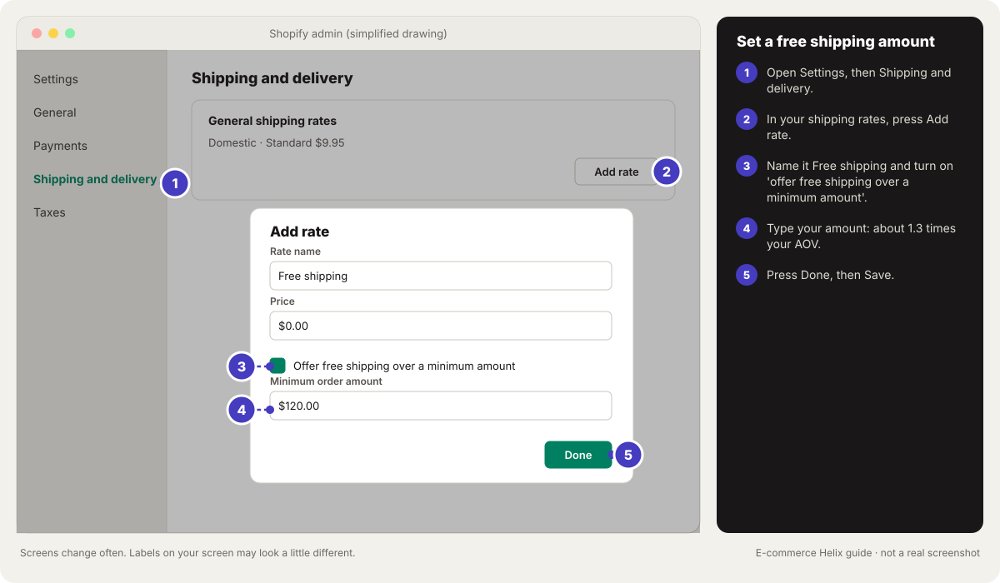

# Module 9: Your store: more sales per visit and bigger orders

**Outcome:** a store that turns more visits into sales. It is clear, convincing, easy to buy from, and good at making orders bigger.

**Related SOPs:** [01 Store audit](../sops/01-store-audit.md), [11 Landing pages and CRO](../sops/11-landing-pages-and-cro.md), [12 AOV and cart offers](../sops/12-aov-and-cart-offers.md)

<!-- plain:start -->
> **In plain words**
>
> **Stage:** Convert (turn visits into sales). Every lesson below is tagged with its stage; see [Attract, Convert, Grow](stages.md).
>
> **What it is:** How to turn more of your visitors into buyers, and get bigger orders.
>
> **Why it matters:** If more visitors buy, every ad dollar goes further without spending more.
>
> **Do this:**
>
> 1. Make the top of each product page clear: what it is, price, reviews, add to cart.
> 2. Remove anything that slows checkout and turn on express payment buttons.
> 3. Set a free shipping amount a bit above your average order (about 1.25 times).
>
> **Words to know:**
>
> - **Conversion rate:** Out of every 100 visits, how many end in an order. 2% means 2 orders per 100 visits.
> - **Above the fold:** The part of a page you see before you scroll.
> - **Free shipping threshold:** The order amount where shipping becomes free, like 'Free shipping over $100'.
> - **AOV:** Average order value: total sales divided by number of orders.
>
> All words are explained in the [glossary](../glossary.md).
<!-- plain:end -->

---

## Lesson 9.1: The improvement system
<!-- stage:convert -->

**Why this matters:** CRO (conversion rate optimisation) means getting more of your visitors to buy. A simple monthly loop beats random changes, because each fix is chosen for its likely payoff and then measured.

**Step 1.** Score each key page against the checklists in Lesson 9.2 and list every gap.

**Expected result:** You have a list of missing items per page.

<!-- do:insights -->

**Step 2.** Rank each gap by how much it helps divided by how much work it is. Sort into quick wins, small builds and big builds.

**Expected result:** Your list is in priority order with quick wins at the top.

**Step 3.** Build the top quick wins using theme settings or apps first.

**Expected result:** The quick wins are live. Pay for custom code only once an idea has proven it works.

**Step 4.** Measure with heatmaps, session recordings, funnel reports and A/B tests (Lessons 9.8 and 9.9).

**Expected result:** Each change has a before and after number.

**Step 5.** Add a monthly reminder to repeat the loop.

**Expected result:** The next review is in your calendar.

<!-- do:calendar -->

## Lesson 9.2: Page checklists
<!-- stage:convert -->

**Why this matters:** Each page type has a short list of things shoppers expect. Missing items cost sales quietly. Above the fold means what people see before they scroll. On a phone that space is tiny, so it must work hard.

**Step 1.** Check the top of your home page on your phone, before you scroll. You want a promo bar ("Free shipping over $80") and a simple menu. Add a banner with one message and its own phone image. Add one clear button and a trust sign (star rating, customer count or press logo).

**Expected result:** All five items are visible without scrolling on a phone.

**Step 2.** Check the lower part of the home page. Look for best sellers, categories, reasons to buy, reviews, your story, press and an email sign-up.

**Expected result:** Each section is present, in roughly that order.

**Step 3.** Check the top of each product page. You want the title and one line on what makes it different. Add the star rating, and the price with a compare-at price or bundle value. Add an offer ("Buy 2, save 10%"), a size or colour picker and Add to cart. Add a delivery estimate and trust badges (secure checkout, free returns).

**Expected result:** All nine items show before scrolling on mobile.

**Step 4.** Check the lower part of product pages. Look for reasons to buy, how to use it, photo reviews, FAQs, a comparison, guarantees and "goes well with" products.

**Expected result:** Shoppers who scroll find answers to every common doubt.

**Step 5.** Check collection pages. Look for filters you can combine with an easy reset, and sort by best selling. Add badges (new, best seller, low stock) and quick add to cart.

**Expected result:** Shoppers can narrow and buy from a collection in a few taps.

**Step 6.** Check cart and checkout. You want a progress bar to free shipping or a gift, and one upsell spot. Add fast pay buttons (Shop Pay and the phone and online wallets Shopify offers), no surprise fees, and trust badges with policy links.

**Expected result:** Checkout has no surprises and the fastest pay options.

**Watch out:** If an optional add-on annoys people (for example shipping protection ticked by default) and hurts conversion, remove it.

**Watch out:** A compare-at price is a "was" price. It must be a real price you charged recently, or it can break consumer law (Lesson 13.4).

## Lesson 9.3: Accessibility basics
<!-- stage:convert -->

**Why this matters:** Accessibility means everyone can use your store. That includes people who cannot see well or who use a keyboard instead of a mouse. Some fixes, like alt text, also help search engines understand your pages.

**Step 1.** Run your text and button colours through a free online contrast checker.

**Expected result:** Body text and buttons pass at least the AA level. For normal text that means a contrast ratio of 4.5 to 1 (see [W3C: contrast minimum](https://www.w3.org/WAI/WCAG22/Understanding/contrast-minimum.html)).

**Step 2.** Add alt text to every product image in Shopify **Products > [product] > Media**. Alt text is a short description for screen readers.

**Expected result:** Every image has a short, descriptive alt text.

**Step 3.** Tab through your store with only the keyboard, from home page to checkout.

**Expected result:** You can reach and use every link, button and form field.

**Step 4.** Check font sizes (at least 16px on phones is a common rule of thumb). Every form field needs a label, and every video needs captions.

**Expected result:** Text is easy to read, forms are labelled and videos have captions.

## Lesson 9.4: Speed
<!-- stage:convert -->

**Why this matters:** Most shoppers use a phone, and a slow page loses them before they see what you sell. Google measures speed with three Core Web Vitals, explained in Step 5.

**Step 1.** Run your home page and a product page through PageSpeed Insights (pagespeed.web.dev) on mobile.

**Expected result:** You have a load time and a list of the biggest issues.

**Step 2.** Compress images and videos (aim for product images under about 300 KB).

**Expected result:** Image files are smaller and pages load faster.

**Step 3.** Remove apps and scripts you do not use. Set images and videos lower on the page to load only when people scroll to them.

**Expected result:** Fewer scripts run on each page.

**Step 4.** Make sure spam protection is on in Shopify's **Online Store > Preferences**. It turns on a bot check for contact forms and account sign-ups. Shopify turns it on by default.

**Expected result:** Fewer fake sign-ups and spam messages reach you (see [Shopify: online store preferences](https://help.shopify.com/en/manual/online-store/setting-up/preferences)).

**Step 5.** In Shopify, find the web performance reports under **Analytics > Reports** (type a colon ":" in the search box to list them). They show the three Core Web Vitals for real visitors.

**Expected result:** You know if your store passes Google's "good" levels. LCP (main image or text showing) is 2.5 seconds or less. INP (reaction to a tap) is 200 milliseconds or less. CLS (page jumping around) is 0.1 or less (see [Google: Web Vitals](https://web.dev/articles/vitals)).

**Step 6.** After your fixes, run the same two pages through PageSpeed Insights again.

**Expected result:** You have a before and after result for each page.

**Step 7.** On your phone, using mobile data, try to buy something and fix anything hard to tap or read.

**Expected result:** The main product image shows in about 2.5 seconds and buying is easy.

**Watch out:** Only chase fixes that save a second or more. Tiny gains are not worth the effort.

## Lesson 9.5: Words that help people buy
<!-- stage:convert -->

**Why this matters:** Copy means the words on your site. Specific words in your customers' own language sell; vague claims do not.

**Step 1.** Rewrite the first line of each product description to lead with the result the customer gets.

**Expected result:** The first line says what changes for the customer.

**Step 2.** Replace vague claims with specific ones ("dries in 2 hours", not "dries fast"), using phrases from reviews.

**Expected result:** Every claim is specific and in customer words.

**Step 3.** Add answers to the top worries, then break the text into short sentences, subheadings and bullet points.

**Expected result:** The page is easy to scan on a phone.

**Step 4.** End each section with a clear button telling shoppers what to do.

**Expected result:** There is always a next step visible.

## Lesson 9.7: Landing pages
<!-- stage:convert -->

**Why this matters:** A landing page is a page built for one ad or one offer. Matching the page to the ad's message usually lifts conversion, and you can test one in 48 hours.

**Step 1.** Pick one type: a list ("5 reasons..."), a comparison or a founder story. Or a bundle builder, or a sale collection page.

**Expected result:** You have chosen a page type that matches your ad.

**Step 2.** Build it in a page builder app with sections in this order. Hook headline, the problem, your answer, 3 to 5 reasons to buy, proof, the offer, FAQ, final button.

**Expected result:** The page is live with all eight sections.

**Step 3.** Send half the ad traffic to the new page and half to the normal product page.

**Expected result:** Both pages get similar traffic from the same ads.

<!-- do:meta-draft -->

**Step 4.** After about 2 weeks, keep the page with the higher revenue per visit.

**Expected result:** The winner becomes the default for that ad.

## Lesson 9.8: Measurement
<!-- stage:convert -->

**Why this matters:** Measuring shows you where shoppers get stuck. Heatmaps show behaviour, store reports show the funnel, and a fixed checklist finds the cause of sudden drops fast.

**Step 1.** Install a heatmap and recording tool (free ones exist). Watch 20 recordings of phone visitors.

**Expected result:** You have noted rage clicks (many angry clicks) and dead clicks (clicks on things that are not links). You know how far people scroll.

**Step 2.** In Shopify, open **Analytics > Reports > Conversion rate breakdown**. Read the steps: sessions, added to cart, reached checkout, then completed checkout.

**Expected result:** You know which step loses the most people (see [Shopify: behaviour reports](https://help.shopify.com/en/manual/reports-and-analytics/shopify-reports/report-types/default-reports/behaviour-reports)).

<!-- do:metrics -->

**Step 3.** In Google Analytics, check traffic sources, landing pages that convert and referrals from AI assistant websites.

**Expected result:** You know where your best visitors come from.

**Step 4.** When conversion drops suddenly, check in this order: tracking, site errors and payment methods. Then stock, price changes, where visitors come from and rival sales.

**Expected result:** You find the cause in minutes rather than days.

## Lesson 9.9: A/B testing
<!-- stage:convert -->

**Why this matters:** An A/B test shows two versions of a page to two halves of your visitors. It shows which one sells more. One change at a time, run to about 95% confidence, makes results trustworthy.

**Step 1.** Pick one thing to change, for example a cart drawer versus a cart page.

**Expected result:** The test changes only one thing.

**Step 2.** Set up the test in your testing app with a 50/50 split.

**Expected result:** Each version gets half the visitors.

**Step 3.** Wait until the app shows about 95% confidence (also called significance).

**Expected result:** You have a result you can trust.

**Step 4.** Write the test, result and decision in a test log.

**Expected result:** Every test is recorded so wins add up and nothing is retested by accident.

## Lesson 9.10: Order value
<!-- stage:convert -->

**Why this matters:** AOV is average order value: sales divided by orders. It decides how much you can pay to win each customer. Raising it makes every visitor worth more, but only if just as many people still buy.

**Step 1.** Set levels. Free shipping at one amount, a free gift at a higher amount, and a discount at a higher one again.

**Expected result:** The cart shows shoppers what they unlock next.

**Step 2.** Add a bundle or bundle builder (customers pick items for a set price).

**Expected result:** At least one bundle is live on your best seller's page.

**Step 3.** Add "goes well with" suggestions in the cart and a one-click offer on the thank-you page after purchase.

**Expected result:** Shoppers see one useful extra before and after paying.

**Step 4.** Add quantity breaks ("buy 3, save 15%") and, for things people use up, subscriptions with an easy skip.

**Expected result:** Repeat and bulk buyers have a reason to buy more.

**Watch out:** Judge every order-value idea by RPV (revenue per visit), not just AOV. A bigger order is no good if fewer people buy.

### Good to know

Free-gift tiers:

- Set the first gift level about 25 to 35% above your current order value. If orders average $60, try a gift at $80.
- Pick a gift that costs you under about 10% of that level (under $8 at $80) but looks worth much more. A sample of something you want people to try next works well.
- Add a second, bigger gift at a higher level, for example $120.
- Shopify's **Buy X get Y** discount never puts the gift in the cart by itself. The shopper has to add it, or you use a free-gift app (see [Shopify: Buy X get Y](https://help.shopify.com/en/manual/discounts/discount-types/buy-x-get-y)).
- Order enough gift stock before the offer starts.

## Lesson 9.11: Shipping psychology
<!-- stage:convert -->

**Why this matters:** How you handle shipping changes how much people buy. A widely quoted rule of thumb is that about 7 in 10 online carts are abandoned. Surprise extra costs like shipping, tax and fees are one of the most common reasons shoppers give. A free shipping amount set in the right place makes many people add one more item.

**Step 1.** Set your free shipping amount.

1. In Shopify **Analytics**, find your average order value (AOV).
2. Multiply it by 1.25. That's your free shipping amount (a common rule of thumb).
3. Open **Settings**, then **Shipping and delivery**, and set free shipping from that amount.

**Expected result:** A free shipping rate appears at your chosen amount.

**Step 2.** Show delivery estimates on the product page and in the cart.

**Expected result:** Shoppers know when it will arrive before checkout.

**Step 3.** Add express shipping as a paid upgrade.

**Expected result:** Shoppers in a hurry can pay to get it faster.

**Step 4.** Show shipping costs before checkout (in the cart or on the product page).

**Expected result:** No one meets a surprise cost at checkout.

### Good to know

<!-- guide:shopify-2-free-shipping -->

*Drawing, not a real screenshot. Labels on your screen may look a little different.* Official help: [Shopify: set up shipping rates](https://help.shopify.com/en/manual/fulfillment/setup/shipping-rates/setting-up-shipping-rates)
<!-- /guide:shopify-2-free-shipping -->

## Lesson 9.12: Promotions without destroying margin
<!-- stage:convert -->

**Why this matters:** Margin is the share of each sale you keep, and big store-wide discounts eat it. There are better ways to give people a reason to buy.

**Step 1.** Swap your next store-wide discount for a free gift or a bundle. Or try early access for best customers, or a loyalty reward.

**Expected result:** Your next promotion protects margin.

<!-- do:calendar -->

**Step 2.** To discount less often, run fewer sales and talk more about value. Keep the best offers for new customers only.

**Expected result:** Discounts become rarer without a sudden drop in sales.

## Lesson 9.13: Special cases
<!-- stage:convert -->

**Why this matters:** Some stores have special needs: expensive products, preorders, video shopping, big catalogues, wholesale or overseas customers. Each has a few proven fixes.

**Step 1.** For pricey products people think about for a while, give them what they need to decide.

- A comparison table with other options.
- Payment plans.
- Samples, swatches or a quick call.
- Retargeting (ads to past visitors) that runs for 30 days or more.

**Expected result:** Long decisions have the content they need.

**Step 2.** For preorders and made-to-order, show clear dispatch dates, offer a deposit option and send progress updates.

**Expected result:** Preorder buyers know exactly what to expect.

**Step 3.** Add videos people can shop from and a "wall of love" review page. Ask for reviews after people have used the product.

**Expected result:** Proof and video show on product and home pages.

<!-- do:flow-review-request -->

**Step 4.** Fix site search: add synonyms, push best sellers up and never show a "no results" dead end.

**Expected result:** Every search shows something useful.

**Step 5.** Fill in product details in Shopify metafields. If it fits your store, set up wholesale prices behind a login, and local currency for overseas (Module 15).

**Expected result:** Filters work better, AI assistants can read your products, and special buyer groups are served.

## Lesson 9.14: Working with developers
<!-- stage:convert -->

**Why this matters:** Apps and developers can speed you up or slow your store down for years. A few checks before you commit keep costs and speed under control.

**Step 1.** Before you add any app, check its cost and how much it slows the site. Also check its support and how hard it is to remove.

**Expected result:** Each new app has passed four checks.

**Step 2.** Get written prices for custom work. Choose a developer by their past work plus a small paid test job.

**Expected result:** You hire on evidence.

**Step 3.** Write a brief with the goal and a user story ("As a shopper, I want..."). Add the design, how you know it is done, and the deadline.

**Expected result:** The developer knows exactly what done looks like.

**Watch out:** Only change your whole theme when the current one blocks several important fixes.

## Lesson 9.15: Category patterns from store audits
<!-- stage:convert -->

**Why this matters:** Stores in the same category usually miss the same things. Checking your category's common gaps is a fast way to find quick wins.

**Step 1.** Find your category in the table below.

**Expected result:** You have the list of common gaps for your category.

**Step 2.** Check your store for each gap. Add the ones you are missing to your CRO list (Lesson 9.1).

**Expected result:** Your improvement list includes the category's common fixes.

### Good to know

| Category | What is usually missing |
| --- | --- |
| Clothing | Size guidance, fit reviews, model height and size, outfit suggestions |
| Kids and baby | Safety proof, age guidance, gift bundles |
| Beauty and supplements | Clear ingredients, how long until results, rules on before-and-after photos, subscriptions |
| Accessories and jewellery | Photos that show size, gift packaging, personalisation |
| Home and living | Dimensions, photos in a room, swatches, clear delivery info |
| Food | What it tastes like, freshness, bundles, subscriptions |
| Pets | Proof for specific pets, refills |

## Lesson 9.16: When conversion suddenly drops: a 20-minute check
<!-- stage:convert -->

**Why this matters:** A conversion rate that halves overnight is almost never because shoppers changed their minds. It is usually something broken, a change in who is visiting, or a tracking fault. Checking in the right order finds the cause in minutes instead of days.

**Step 1.** Confirm the drop is real. Compare orders in Shopify (not ad platform numbers) for the last 3 days with the same days last week. Check sessions too.

**Expected result:** You know whether orders really fell, or only reported conversions or sessions changed.

**Step 2.** Buy something yourself on your phone and on a computer. Add to cart, reach checkout and pay with a real card and a phone wallet. Then refund it.

**Expected result:** Every step works, or you found the broken one. It is often a payment method, discount code or new app.

**Step 3.** Look at what changed in the last 7 days. Think about theme edits, new or updated apps, prices and shipping rates. Also a sold-out best seller, or a new ad sending different visitors. Undo the most likely change first.

**Expected result:** You have a short list of recent changes, and the most likely cause has been undone or fixed.

**Step 4.** Split conversion by device and by traffic source in Shopify Analytics. A drop on one device points at the site; a drop from one source points at that traffic.

**Expected result:** You know whether the problem is the site, one device, or one traffic source.

**Watch out:** Do not cut ad spend in a panic before Step 2. If checkout is broken, every channel looks bad at once.

## Lesson 9.17: Your store gap check
<!-- stage:convert -->

**Why this matters:** A gap check compares your store with what buyers expect to see. Then you fix the biggest gaps first instead of guessing.

**Step 1.** Open **What to fix** in Helix and look at **Your store check**.

**Expected result:** You see up to 5 fixes, each quoting something from your own store.

**Step 2.** Pick the top fix only. Write it at the top of a note.

**Expected result:** You have one fix to work on, not five.

**Step 3.** Open the lesson linked under that fix and do its steps.

**Expected result:** The fix is live on your store.

**Step 4.** On your phone, open the page you changed and look over the whole page.

**Expected result:** The change shows on a phone and nothing else moved or broke.

**Step 5.** On Starter, wait for your monthly re-check. On Free, tick the fix done and move to the next one.

**Expected result:** The fix no longer shows in your list, or is ticked as done.

## Lesson 9.18: A product-finder quiz
<!-- stage:convert -->

**Why this matters:** When you sell many products, shoppers can freeze. A short quiz asks a few questions and points them to the right one. Their answers also tell you what they want, so your emails can match.

**Step 1.** Write down the 3 to 5 questions you would ask a shopper in person. For example: skin type, main worry, budget.

**Expected result:** A short list of questions, each with 2 to 4 answers.

**Step 2.** Match each mix of answers to one product or bundle.

**Expected result:** Every path through the quiz ends on a product.

**Step 3.** Install a quiz app from the Shopify App Store (search "product quiz"). Build your questions in it.

**Expected result:** The quiz works on a phone and takes under a minute.

**Step 4.** Ask for an email just before the result. Send the answers to your email tool as tags or fields.

**Expected result:** Each quiz email lands in your list with their answers saved.

**Step 5.** Add a "Find your match" button to your home page and menu. Send quiz takers a welcome email that talks about their answers.

**Expected result:** Quiz takers get a product pick and emails that fit them.

**Step 6.** After 30 days, compare conversion for quiz takers with everyone else.

**Expected result:** You know if the quiz earns its place for your store.

**Watch out:** Keep it short. Each extra question loses some people. Five questions is plenty.

## Lesson 9.19: Video on product pages
<!-- stage:convert -->

**Why this matters:** Photos show what a product looks like. Video shows it working. A short clip of a real person using it answers questions that words cannot.

**Step 1.** Pick your best-selling product. Gather 3 short clips: someone using it, a close-up, and a customer talking about it.

**Expected result:** 3 clips, each under 30 seconds, filmed upright on a phone.

**Step 2.** Add one clip as the second item in the product photos, after the main photo.

**Expected result:** Shoppers see the product moving within one swipe.

**Step 3.** Make sure the clips play muted and have captions. Keep each file small so the page stays fast (Lesson 9.4).

**Expected result:** The page loads as fast as before on a phone.

**Step 4.** If you have many clips, try a shoppable video app from the Shopify App Store. It shows a row of clips with a buy button on each.

**Expected result:** Shoppers can watch and add to cart without leaving the video.

**Step 5.** Test for 2 weeks with and without the video (Lesson 9.9). Compare add-to-cart rate.

**Expected result:** You know if video helps this product, and you add it to the next best seller.

**Watch out:** Ad clips that worked well often make great product page clips. Reuse them, but check your rights first (Lesson 19.4).

## Self-check

1. What is the funnel you watch in store reports?
2. Where should the free shipping amount sit?
3. Name three alternatives to a store-wide discount.
4. What do you check first when conversion suddenly drops?

Answers

1. Sessions, then add to cart, then reached checkout, then purchase.
2. A bit above your average order value (AOV), about 1.25 times as a rule of thumb.
3. Any three of: a free gift, bundles, early access for best customers, loyalty rewards.
4. Confirm the drop is real in Shopify orders and tracking, then test checkout and payments. Then check recent changes, stock, prices and traffic sources.

