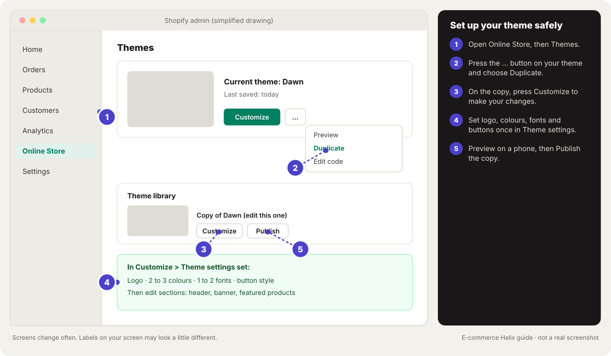
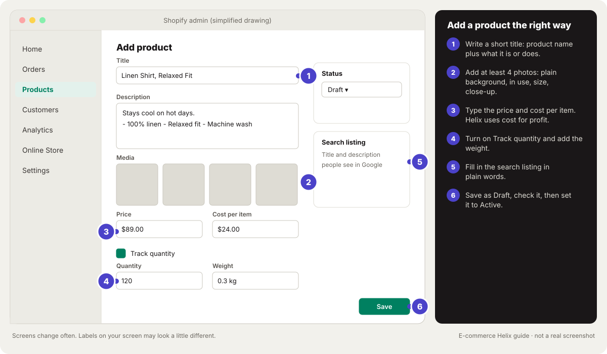
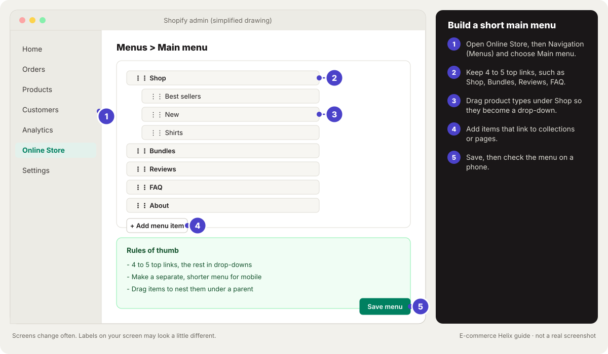
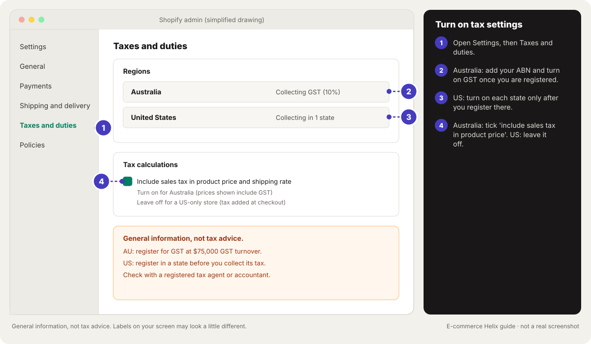
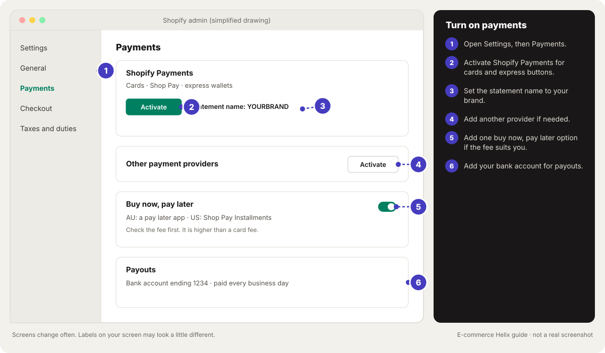
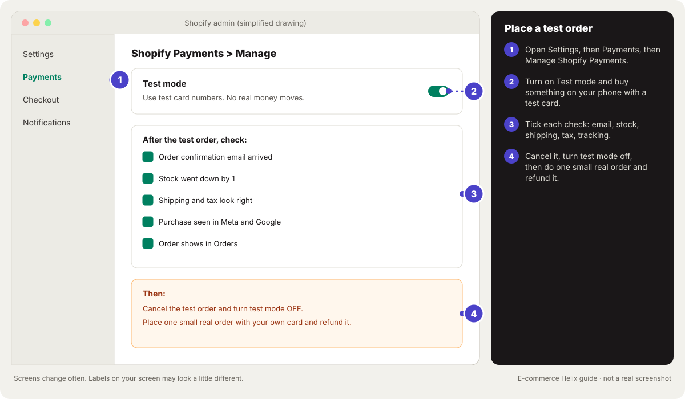

# Module 13: Shopify store setup

**Outcome:** a Shopify store that is ready to take real orders. It has your own domain, a fast theme, and clear home and product pages. Shipping, taxes and payments work, and policies are plain. It has a small set of apps and tracking for your ads. And a test order went all the way through.

**Related:** [Module 14 Website, conversion and order value](14-website-and-cro.md), [Module 29 Choosing your tool stack](29-tool-stack.md), [Module 8 Meta ads in practice](08-meta-ads.md), [Module 1 Daily profit foundations](01-daily-profit-foundations.md)

<!-- plain:start -->
> **In plain words**
>
> **Stage:** Convert (turn visits into sales). Every lesson below is tagged with its stage; see [Attract, Convert, Grow](stages.md).
>
> **What it is:** We build your Shopify store one small step at a time. We stop when it is ready for real orders.
>
> **Why it matters:** A clear, fast, trustworthy store makes every ad dollar go further. Mistakes in tax, payments or tracking are hard to fix later.
>
> **Do this:**
>
> 1. Get your domain, pick a free theme and build the home and product pages.
> 2. Set shipping, taxes, payments and plain-language policies.
> 3. Install tracking, check speed on a phone and place a test order before launch.
>
> **Words to know:**
>
> - **Theme:** The design template for your Shopify store. It controls how every page looks.
> - **Domain:** Your store's web address, like yourbrand.com.
> - **Variant:** One option of a product, like a size or colour, with its own stock and price.
> - **GST:** Goods and services tax. Each country sets its own rate, such as 10% (Australia) or 15% (New Zealand). Registered businesses add it to most sales.
> - **Sales tax:** In the US, a tax set by most states (and many local areas) that the seller collects at checkout.
> - **Test order:** A pretend order you place yourself to check payments, emails and tracking work.
>
> All words are explained in the [glossary](../glossary.md).
<!-- plain:end -->

---

## Lesson 13.1: Plan before you build
<!-- stage:convert -->

**Why this matters:** A store takes days to build and minutes to judge. Planning first means you build only what a buyer needs and know your numbers before the first sale. This takes about an hour.

**Step 1.** Write your one-line promise: who it is for and the result they get.

**Expected result:** You can say in one sentence what you sell and who it is for.

**Step 2.** List your products with price, product cost and what one order costs you to send.

**Expected result:** You know your cost per order for each product.

<!-- do:numbers -->

**Step 3.** Choose one launch country (for example, where you live) and add more later.

**Expected result:** You have one launch country.

**Step 4.** Pick the cheapest Shopify plan that has the features you need. Most new stores start on Basic (check [Shopify pricing](https://www.shopify.com/pricing)).

**Expected result:** You know your monthly platform cost. In October 2026, Basic was US$39 or A$56 a month, billed monthly.

**Step 5.** Gather your logo, 4 to 8 photos per product and your returns rule. Also your ABN or EIN (US, if you have one) and a business bank account.

**Expected result:** Everything you need to build is in one folder.

**Watch out:** Outside the US: the ATO's GST limit is $75,000 in sales a year. If you may reach it, read Lesson 13.10 before you set prices. US: your home state is where you are most likely to owe sales tax first.

## Lesson 13.2: Domain and email
<!-- stage:convert -->

**Why this matters:** Your domain is your web address. A store on its own domain looks more trustworthy than the free myshopify.com address. Emails from your own domain also land in inboxes more often.

**Step 1.** In Shopify, go to **Settings > Domains**. Buy a short domain that matches your brand, or connect one you own (see [Shopify: domains](https://help.shopify.com/en/manual/domains)).

**Expected result:** The domain shows as connected in Settings.

**Watch out:** Outside the US: a .com.au needs a local business link, usually an ABN or ACN (see [auDA: .com.au](https://www.auda.org.au/au-domain-names/the-different-au-domain-names/com-au-domain-names/)). Many brands own both .com.au and .com. US: .com is the normal choice.

**Step 2.** Set it as the primary domain so myshopify.com redirects to it.

**Expected result:** Typing your domain opens your store.

**Step 3.** Set up a brand email like hello@yourbrand.com. Use it for support and as the sender in your email tool.

**Expected result:** Customer emails come from your own domain.

**Step 4.** Send a test email to yourself.

**Expected result:** It lands in your inbox, not spam.

## Lesson 13.3: Choose and set up a theme
<!-- stage:convert -->

**Why this matters:** The theme is the design of your store. A fast, simple theme beats a fancy slow one. Always edit a copy, so you never break the live store.

**Step 1.** In **Online Store > Themes**, start with a free Shopify theme such as Horizon or Dawn (see [Shopify: themes](https://help.shopify.com/en/manual/online-store/themes)).

**Expected result:** A fast, supported theme is installed.

**Watch out:** Only pay for a theme if it has a feature you truly need. Check its speed on a phone first.

**Step 2.** Click **Duplicate** on the theme and make all changes on the copy.

**Expected result:** You are working on a copy, not the live theme.

**Step 3.** In **Customize > Theme settings**, set your logo, 2 to 3 colours and 1 to 2 fonts. Pick a button style.

**Expected result:** Your store uses no more than 2 fonts and 3 main colours.

**Step 4.** Plan menus for desktop and mobile separately, with fewer, bigger links on phones.

**Expected result:** The mobile menu has 5 or fewer links.

### Good to know

<!-- guide:shopify-3-theme-editor -->

*Drawing, not a real screenshot. Labels on your screen may look a little different.* Official help: [Shopify: themes](https://help.shopify.com/en/manual/online-store/themes)
<!-- /guide:shopify-3-theme-editor -->

## Lesson 13.4: Build the home page
<!-- stage:convert -->

**Why this matters:** The home page should answer three questions in a few seconds. What is this? Is it for me? Why should I trust it? Build the top first, then the sections below in a proven order.

**Step 1.** In the theme editor, add a promo bar with one short line. Use your shipping offer or a guarantee.

**Expected result:** The promo bar shows at the very top on every page.

**Step 2.** Set the header menu to your logo plus 4 to 5 links. For example: Shop, Bundles, Reviews, FAQ, About.

**Expected result:** The header is simple and uncluttered.

**Step 3.** Add a banner with a photo of the product in use. Add your promise in one line and one button ("Shop now"). You can add a row of category tiles people swipe sideways on phones.

**Expected result:** The top of the page says what you sell and gives one next step.

**Step 4.** Below the banner, add these sections in this order. Use **Add section** in the theme editor for each.

1. 3 points on what makes you different.
2. Best sellers with prices.
3. Reasons to buy.
4. Proof: rating, customer count, press.
5. How it works, in 3 steps.
6. Customer photos and reviews.
7. Expert backing, if you have it.
8. Email sign-up and a simple footer.

**Expected result:** The home page has every section in a logical order.

**Step 5.** Show your home page on a phone to someone new for 5 seconds.

**Expected result:** They can say what you sell.

## Lesson 13.5: Product pages: titles, photos and descriptions
<!-- stage:convert -->

**Why this matters:** Most buying decisions happen on the product page. Answer every worry before the buyer has to ask. Keep price, rating and Add to cart easy to see on a phone.

**Step 1.** Write a short title: the product name plus what it does or is made of. For example: "Linen Shirt, Relaxed Fit".

**Expected result:** The title is clear and short.

**Step 2.** Upload at least 4 square photos. Show a plain background, the product in use, its size, and a close-up of the key detail.

**Expected result:** The gallery answers "what does it look like in real life".

**Step 3.** Make sure price, star rating with review count, promise line and Add to cart sit near the top.

**Expected result:** On a phone you see price, rating and Add to cart without scrolling.

**Step 4.** Write the description as short lines. Put the result first, then 3 to 5 key points, then what is included. Add a short FAQ under the button: sizing, materials, shipping time, returns and care.

**Expected result:** Common questions are answered on the page.

**Step 5.** Turn on sticky Add to cart for phones in theme settings. Fill in the search title and description in plain words (see [Shopify: products](https://help.shopify.com/en/manual/products/add-update-products)).

**Expected result:** The button stays visible as people scroll, and Google shows a clean listing.

### Good to know

<!-- guide:shopify-4-add-product -->

*Drawing, not a real screenshot. Labels on your screen may look a little different.* Official help: [Shopify: adding products](https://help.shopify.com/en/manual/products/add-update-products)
<!-- /guide:shopify-4-add-product -->

**Extra details on every page:** Shopify lets you add your own fields to products, called metafields. Use them for things like care steps, sizing or ingredients. Then your theme shows them in the same spot on every product page. Find them under **Settings**, then **Metafields and metaobjects** (see [Shopify: metafields](https://help.shopify.com/en/manual/custom-data/metafields)).

## Lesson 13.6: Variants and inventory
<!-- stage:convert -->

**Why this matters:** Variants are the options of one product, like size or colour. Inventory is how many you have. Setting them up properly stops overselling and lets Helix work out profit and shipping correctly.

**Step 1.** Add options (Size, Colour) to one product instead of separate products (see [Shopify: variants](https://help.shopify.com/en/manual/products/variants)).

**Expected result:** One product page shows every option.

**Step 2.** Give each variant its own photo, and its own price if it differs. Add a SKU (your code for each version) and a stock count.

**Expected result:** Every variant is complete.

**Step 3.** Turn on **Track quantity** and choose to stop selling at zero. If you take preorders, state a clear ship date (see [Shopify: inventory](https://help.shopify.com/en/manual/products/inventory)).

**Expected result:** Shopify stops selling when you run out.

**Step 4.** Fill in **Cost per item** and weight on every variant.

**Expected result:** Helix can work out profit and Shopify can calculate shipping.

<!-- do:stock -->

## Lesson 13.7: Reviews
<!-- stage:convert -->

**Why this matters:** People trust other customers more than they trust you. A review app collects and shows reviews automatically, and honest replies to bad reviews build more trust than hiding them.

**Step 1.** Install one review app that collects photo reviews and sends a request email after delivery.

**Expected result:** Review requests go out automatically.

<!-- do:flow-review-request -->

**Step 2.** Show the star rating under the product title and near Add to cart. Add a photo review section lower on product pages and the home page.

**Expected result:** Your rating is visible near the top of every product page.

**Step 3.** Ask early buyers, testers and friends who used the product for honest reviews.

**Expected result:** Your first products have real reviews.

**Watch out:** Never write fake reviews or pay for positive ones. Both breach consumer law in most countries (see [FTC: fake reviews rule](https://www.ftc.gov/news-events/news/press-releases/2024/08/federal-trade-commission-announces-final-rule-banning-fake-reviews-testimonials)).

**Step 4.** Reply to negative reviews politely and fix the problem.

**Expected result:** Shoppers see you handle problems well.

## Lesson 13.8: Collections, menus and search
<!-- stage:convert -->

**Why this matters:** Collections are groups of products, and menus and search help people find them. A new visitor should reach any product in 3 taps or fewer.

**Step 1.** Make collections for Best sellers, New, and one per product type. Use automatic collections where you can (see [Shopify: collections](https://help.shopify.com/en/manual/products/collections)).

**Expected result:** Collections update themselves as products change.

**Step 2.** Build the main menu with 4 to 5 links and deeper links in drop-downs (see [Shopify: menus](https://help.shopify.com/en/manual/online-store/menus-and-links)).

**Expected result:** Any product is 3 taps away.

**Step 3.** Turn on Shopify's filters (size, colour, price, in stock) and let people pick more than one. If your theme allows, add a second photo on hover and quick add.

**Expected result:** Shoppers can narrow and add from collections.

**Step 4.** Search for your top 5 product words and a common misspelling.

**Expected result:** Every search returns the right products.

### Good to know

<!-- guide:shopify-5-menus -->

*Drawing, not a real screenshot. Labels on your screen may look a little different.* Official help: [Shopify: menus and links](https://help.shopify.com/en/manual/online-store/menus-and-links)
<!-- /guide:shopify-5-menus -->

## Lesson 13.9: Shipping zones, rates and a free-shipping amount
<!-- stage:convert -->

**Why this matters:** Surprise extra costs, like shipping, are one of the most common reasons people leave at checkout. Simple rates, a free shipping amount and honest delivery ranges fix most of it.

**Step 1.** In **Settings > Shipping and delivery**, create a zone for your home country.

**Expected result:** A home country zone exists.

**Step 2.** Add Standard and Express rates priced from real carrier costs, or use calculated rates.

**Expected result:** Checkout shows two clear options.

**Step 3.** A common rule of thumb is to set free shipping about 20 to 30% above your average order (1.2 to 1.3 times). Show it in the promo bar and near Add to cart ("Free shipping over $X").

**Expected result:** Shoppers see how close they are to free shipping.

**Step 4.** Write delivery times as a range ("arrives in 3 to 6 business days").

**Expected result:** Checkout shows a clear price and delivery range.

**Watch out:** Outside the US: compare the national post and couriers, and set a separate rate for remote areas if needed. US: compare the carriers offered in Shopify Shipping. Add international zones only once home works.

### Good to know

<!-- guide:shopify-2-free-shipping -->

*Drawing, not a real screenshot. Labels on your screen may look a little different.* Official help: [Shopify: set up shipping rates](https://help.shopify.com/en/manual/fulfillment/setup/shipping-rates/setting-up-shipping-rates)
<!-- /guide:shopify-2-free-shipping -->

## Lesson 13.10: Taxes: GST and sales tax basics
<!-- stage:convert -->

**Why this matters:** Tax set up wrong either costs you money or breaks the law. Under the ATO's rules, you must register for GST once sales reach $75,000 a year. Other countries set their own limits. In the US, sales tax depends on nexus: a strong enough link to a state. Helix strips GST from your sales before any profit maths.

**Step 1.** Outside the US: check your GST turnover (this month plus the last 11). Has it reached $75,000, or will it in the next 12 months? If so, register within 21 days (see [ATO: registering for GST](https://www.ato.gov.au/businesses-and-organisations/gst-excise-and-indirect-taxes/gst/registering-for-gst)).

**Expected result:** You know whether you must register.

**Step 2.** Once registered for GST: in Shopify, go to **Settings > Taxes and duties**. Turn on **Include sales tax in product price and shipping rate** (see [Shopify: tax-inclusive prices](https://help.shopify.com/en/manual/taxes/include-exclude-taxes)).

**Expected result:** Prices shown to local customers include GST.

**Watch out:** If you are not registered, do not charge GST and do not call invoices tax invoices.

**Step 3.** In Helix **Settings**, find **My prices include GST/VAT**. Keep **Use my country's default** if you type or import Shopify's Gross sales, which already leaves tax out. Pick **Yes** only if every sales number you type includes tax. Pick **No** if you are not registered.

**Expected result:** Helix takes GST out of order totals synced from Shopify (for example $110 becomes $100) and uses Gross sales as typed. New Zealand (15%) and UK (20%) are there too.

<!-- do:settings -->

**Step 4.** US: list the states where you are physically present (home state, warehouse). Check each state's sales limit for economic nexus, often $100,000 a year.

**Expected result:** You know where you owe sales tax.

**Step 5.** US: register with each state before you collect tax. Then turn that state on in **Settings > Taxes and duties** (see [Shopify: US taxes](https://help.shopify.com/en/manual/taxes/us)).

**Expected result:** Shopify collects tax only where you are registered and tracks your progress to other thresholds.

### Good to know

> **General information, not tax or legal advice.** Tax rules change and depend on your situation. Check with a registered tax agent or accountant before you decide.

<!-- guide:shopify-6-taxes -->

*Drawing, not a real screenshot. Labels on your screen may look a little different.* Official help: [Shopify: taxes](https://help.shopify.com/en/manual/taxes)
<!-- /guide:shopify-6-taxes -->

## Lesson 13.11: Payments
<!-- stage:convert -->

**Why this matters:** Let people pay the way they like, because every extra step at checkout loses buyers. Express wallets and a recognisable statement name cut drop-offs and disputes.

**Step 1.** In **Settings > Payments**, turn on Shopify Payments if available in your country (see [Shopify Payments](https://help.shopify.com/en/manual/payments/shopify-payments)).

**Expected result:** Cards are accepted. You also avoid Shopify's extra fee for outside payment providers (2% on Basic).

**Step 2.** Turn on Shop Pay and the phone wallets Shopify offers, and add another payment provider your customers trust as an extra option (see [Shopify: third-party payment providers](https://help.shopify.com/en/manual/payments/third-party-providers)).

**Expected result:** Checkout shows express wallet buttons.

**Step 3.** Think about one buy now pay later option. Several providers work in many countries. Shop Pay Installments works in the US, Canada and the UK (see [Shop Pay Installments](https://help.shopify.com/en/manual/payments/shop-pay-installments)).

**Expected result:** Shoppers can pay in parts. Check the fee, which is higher than a card fee.

**Step 4.** Set your payout bank account and a statement name that matches your brand.

**Expected result:** Customers recognise the charge on their bank statement.

**Watch out:** Australia: since 1 October 2026 you cannot add a surcharge for paying by card (Visa, Mastercard, eftpos, American Express or PayPal). Do not add a card fee at checkout; include payment costs in your prices (see [RBA: card payment costs and surcharging FAQs](https://www.rba.gov.au/payments-and-infrastructure/review-of-retail-payments-regulation/2026-03/conclusions-paper/faqs/)).

### Good to know

<!-- guide:shopify-7-payments -->

*Drawing, not a real screenshot. Labels on your screen may look a little different.* Official help: [Shopify Payments](https://help.shopify.com/en/manual/payments/shopify-payments)
<!-- /guide:shopify-7-payments -->

## Lesson 13.12: Policies and legal pages
<!-- stage:convert -->

**Why this matters:** Clear policies build trust and keep you within the law. Write them in plain words a 12-year-old could follow, and link them where buyers look.

**Step 1.** Go to **Settings > Policies**. Make Return and refund, Privacy, Terms of service, Shipping and Contact information pages, starting from Shopify's templates (see [Shopify: store policies](https://help.shopify.com/en/manual/checkout-settings/refund-privacy-tos)).

**Expected result:** All five policy pages exist.

**Step 2.** Rewrite each in plain language with your own cut-off dates and delivery ranges.

**Expected result:** The policies sound like you and match your real process.

**Watch out:** Outside the US: under consumer law, customers always have rights for faulty or wrong products. They can get a repair, replacement or refund. Never write "no refunds" or "no refunds on sale items" (see [ACCC](https://www.accc.gov.au/consumers/buying-products-and-services/consumer-rights-and-guarantees)). US: if you state a shipping time, the FTC mail order rule expects you to meet it. If you state none, ship within 30 days (see [FTC](https://www.ftc.gov/business-guidance/resources/business-guide-ftcs-mail-internet-or-telephone-order-merchandise-rule)).

**Step 3.** Link every policy in the footer and near checkout.

**Expected result:** Every policy is one click away.

**Step 4.** Make sure you only email people who agreed, and every marketing email has an unsubscribe link.

**Expected result:** Your email marketing is compliant.

**Step 5.** Create a sale terms page listing exclusions and dates.

**Expected result:** Shoppers can check sale rules in one click.

**Step 6.** Add a short returns and delivery summary near Add to cart on product pages. Link it to the full policies.

**Expected result:** Shoppers see returns and delivery times before checkout.

**Step 7.** Make contact options easy to find and build a help centre with the top 10 questions.

**Expected result:** Shoppers can find help without emailing you.

**Step 8.** Set up automatic answers for order status and common questions in your help desk or chat app.

**Expected result:** "Where is my order?" gets an instant answer.

### Good to know

> **General information, not legal advice.**

## Lesson 13.13: Essential apps (and only those)
<!-- stage:convert -->

**Why this matters:** Every app can slow your store and adds a monthly cost. A small starter set covers almost everything a new store needs. See Module 29 for when to add more.

**Step 1.** Install the starter set only. That is a reviews app, plus Shopify Email or another email tool. Add the Facebook & Instagram and Google & YouTube channels, and maybe an after-purchase offer app. Add subscriptions only if you sell refills.

**Expected result:** Your app list is short and every app has a job.

**Step 2.** Before you install anything else, check if your theme can already do it. Badges, size charts and FAQs are often built in.

**Expected result:** You avoid apps for features you already have.

**Step 3.** Install new apps on a theme copy and test speed before and after.

**Expected result:** No app slows the live store unnoticed.

**Step 4.** Remove apps you stop using and check they left no code behind.

**Expected result:** You can name what each app does and what it costs each month.

## Lesson 13.14: Place test orders
<!-- stage:convert -->

**Why this matters:** A test order proves that payments, emails, stock and tracking all work together. It is the last step before real customers.

**Step 1.** In **Settings > Payments**, turn on test mode for Shopify Payments. Or use Shopify's test payment gateway, which shows as Bogus Gateway (see [Shopify: test orders](https://help.shopify.com/en/manual/checkout-settings/test-orders)).

**Expected result:** Checkout accepts test card numbers.

**Step 2.** Place an order on your phone as a customer would, with a discount code if you have one.

**Expected result:** The order goes through.

**Step 3.** Check the order email arrived and stock dropped by one. Check shipping and tax were right, and a Purchase showed in Meta and Google.

**Expected result:** Every system recorded the order correctly.

**Step 4.** Refund or cancel the test order and turn test mode off.

**Expected result:** The store is back in live mode.

**Step 5.** Place one small real order with your own card and refund it.

**Expected result:** A real card payment went through and appears in your payouts.

### Good to know

<!-- guide:shopify-9-test-order -->

*Drawing, not a real screenshot. Labels on your screen may look a little different.* Official help: [Shopify: test orders](https://help.shopify.com/en/manual/checkout-settings/test-orders)
<!-- /guide:shopify-9-test-order -->

## Lesson 13.15: Pre-launch checklist
<!-- stage:convert -->

**Why this matters:** Do one last checklist before you launch or turn on ads. It catches the small things that cost the first sales.

**Step 1.** Go through every row of the table below and tick it off.

**Expected result:** Every row is ticked.

**Step 2.** Remove the store password: in **Online Store**, switch the store from **Private** to **Public** (see [Shopify: password page](https://help.shopify.com/en/manual/online-store/themes/password-page)). The first time, the button says **Launch store**.

**Expected result:** Anyone can visit the store.

**Step 3.** Start your 2-minute morning numbers in Helix and plan your first small test campaign.

**Expected result:** Your first day of numbers is in and a test campaign brief is started.

<!-- do:numbers -->

### Good to know

| Area | Check |
| --- | --- |
| Domain | Own domain is primary; emails come from your domain |
| Theme | Published copy you tested; logo, colours and fonts set |
| Home page | Promise, one button and proof visible on a phone |
| Products | 4+ photos, price, rating, FAQ, cost and weight on every variant |
| Collections and menu | 4 to 5 menu links; filters on; search works |
| Shipping | Home zone, clear rates, free-shipping amount shown |
| Taxes | GST or state settings checked (with your accountant) |
| Payments | Cards, Shop Pay and express wallets; statement name set |
| Policies | Return and refund, privacy, terms, shipping and contact linked in footer |
| Apps | Only the starter set; speed checked after each |
| Tracking | Test Purchase seen in Meta and Google |
| Speed | Main product image shows in about 2.5 seconds on a phone (Lesson 14.4) |
| Password | Store password removed when you are ready to launch |

## Lesson 13.16: Sell to people near you
<!-- stage:convert -->

**Why this matters:** Local shoppers can get your products the same day, with no shipping cost. Pickup and local delivery remove a big reason people leave the cart. Local ads can also reach people who walk past your door.

**Step 1.** In Shopify, go to **Settings**, then **Shipping and delivery**. Turn on **Local pickup** if people can collect from you.

**Expected result:** Pickup shows as a free option at checkout for nearby shoppers.

**Step 2.** On the same page, set up **Local delivery** with a delivery area and a price. A small fee or free over a set amount works well.

**Expected result:** Nearby shoppers see a local delivery option at checkout.

**Step 3.** Add a line to your promo bar or home page, such as "Free pickup in Newtown".

**Expected result:** Local shoppers learn about it before checkout.

**Step 4.** If you have a shop front, claim your free Google Business Profile. Add opening hours, photos and a link to your store.

**Expected result:** You show up on Google Maps for people searching near you.

**Step 5.** Try a small local ad with a tight area around you, about $10 a day for 2 weeks. Use a Meta ad with a location set, or a Google campaign aimed at your area.

**Expected result:** You know if local ads bring orders or visits at a cost you can afford.

**Watch out:** Only offer a delivery area you can really reach on time. One late local order hurts more than a slow parcel.

